<p align="center">
  
</p>

<h1 align="center">Know Giver</h1>

<h3 align="center">あなたの試験。あなたのプラン。対話できる先生。</h3>

<p align="center">
  <a href="README.md">English</a> · <a href="README.pt-BR.md">Português (Brasil)</a> · <a href="README.ja.md">日本語</a> · <a href="README.zh-Hans.md">简体中文</a> · <a href="README.zh-Hant.md">繁體中文</a>
</p>

<p align="center">
  <b>試験のための学習プランを作るデスクトップアプリ。純粋な Rust で作られています。</b><br>
  試験要項や出題範囲のPDFを入れると、週ごとのプランができ、話を聞き、説明し、問題を出してくれる先生と一緒に学べます。
</p>

<p align="center">
  <a href="https://www.rust-lang.org"></a>
  <a href="https://github.com/emilk/egui"></a>
  <a href="https://www.sqlite.org"></a>
  <a href="https://typst.app"></a>
  
  <a href="https://github.com/rhasspy/piper"></a>
  
  
  
  
  <a href="#license"></a>
  <a href="https://github.com/czarist/know-giver/tags"></a>
  
  
  <a href="https://github.com/czarist/know-giver/actions/workflows/packages.yml"></a>
</p>

<br>

<p align="center">
  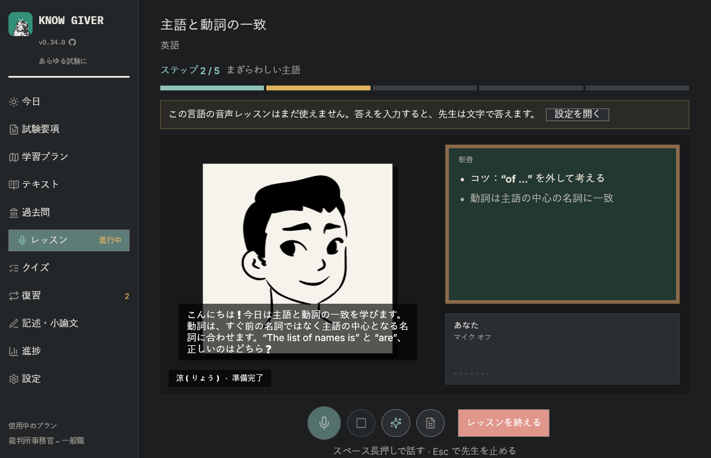
</p>

<p align="center">
  <a href="#試験要項からプランへ">要項 → プラン</a> ·
  <a href="#レッスン">レッスン</a> ·
  <a href="#板書">板書</a> ·
  <a href="#テキストを読んでマーカーを引く">テキスト</a> ·
  <a href="#練習復習テキスト">練習</a> ·
  <a href="#記述小論文">記述・小論文</a> ·
  <a href="#初回設定">初回設定</a> ·
  <a href="#プライバシー">プライバシー</a> ·
  <a href="#はじめかた">はじめかた</a>
</p>

<br>

## 試験要項からプランへ

試験要項はお使いのコンピューターで読み取られ、出題範囲だけがAIに送られます。

- **職種を選ぶ。** 複数の職種を募集する試験もあります。Know Giver は職種を見つけて、どれを受験するか尋ねます。プランには共通科目と、*あなたの*職種の専門科目だけが入ります。
- **あなたの予定に合わせて。** 試験までの週数と1週間の学習時間から、週・科目・トピックごとのプランを作ります。複数の試験を並べて管理できます。
- **スキャンしたPDF。** 文字のないページは、設定した画像対応モデルで書き起こせます。

<p align="center">
  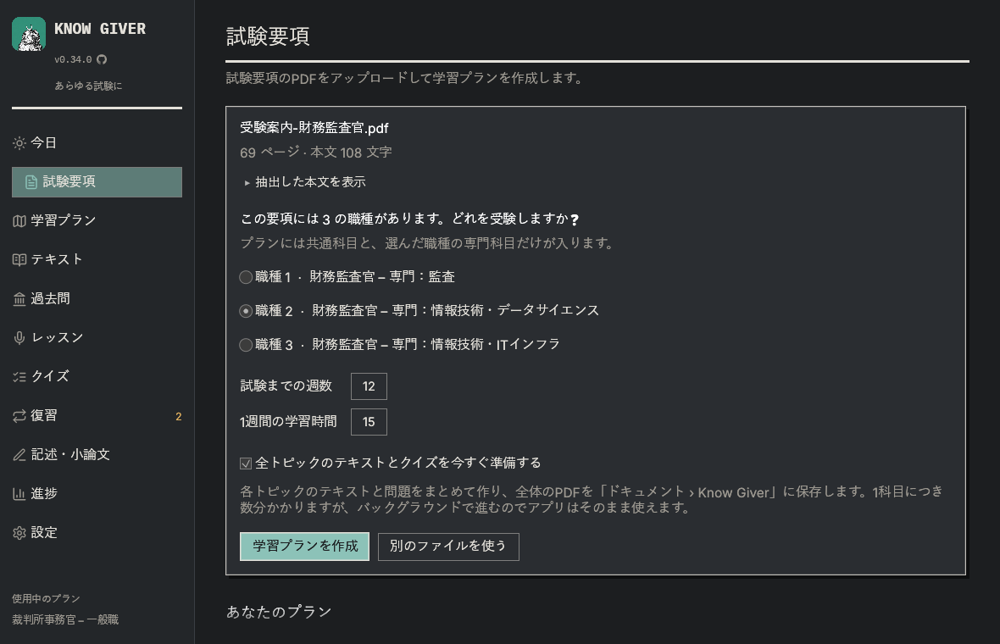
</p>

## レッスン

先生がトピックを、進め方に沿って一歩ずつ教えます。各ステップでテキストの要点を扱い、理解できたか確認してから次へ進み、クイズで問われる内容をすべて取り上げます。最後にまとめと、クイズへの案内があります。「短め」「標準」「じっくり」から長さを選べます。

**日本語のレッスンは、現在は文字でのやり取りです。** 音声（ローカルの音声認識と読み上げ）は、今のところポルトガル語と英語に対応しています。日本語の音声は今後対応予定です。設定でクラウド音声サービスを使うことはできます。

AIは OpenAI 互換のモデルならどれでも使え（Z.ai、Anthropic、OpenAI、Gemini、Ollama など）、先生への指示（プロンプト）はアプリの言語に合わせて日本語になります。

## 板書

要点に加えて、先生は**式**、**図**、**比較表**、**年表**、**マインドマップ**、**試験のポイント**、**例**を書き、Wikipedia の**画像**も表示します（コンピューターから出るのは検索語だけです）。

<p align="center">
  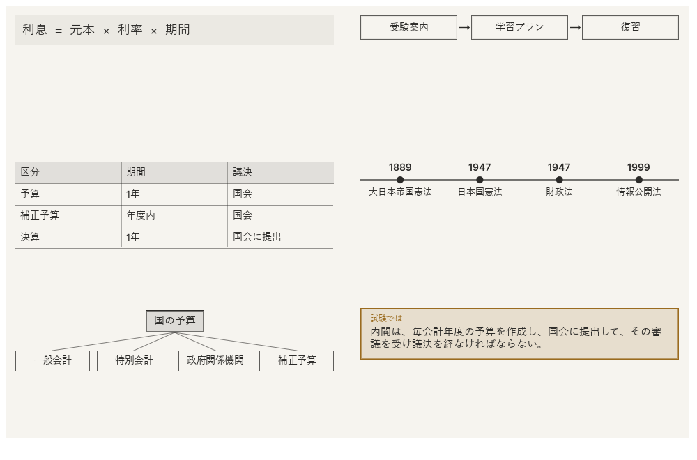
</p>

先生は4人：**遥**、**莉子**、**涼**、**修**。呼吸し、まばたきし、うなずくインクの肖像です。

<p align="center">
  
</p>

## テキストを読んでマーカーを引く

作ったテキストはアプリの中で、PDFとまったく同じページで開きます。文章をドラッグしてマーカーを引き、クリックしてメモを書き、サイドの一覧からすべてのマーカーに移動できます。どこまで読んだかを覚えていて、マーカー付きのPDFも保存できます。

<p align="center">
  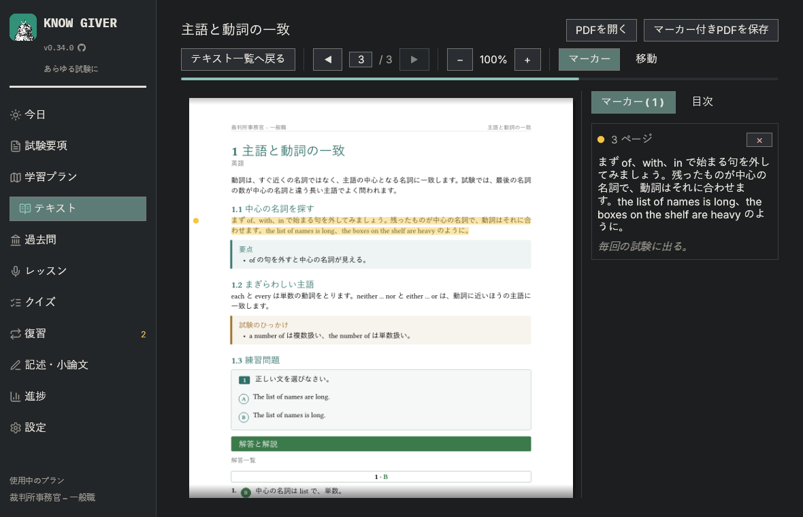
</p>

## 練習・復習・テキスト

- **クイズ**：試験形式の問題と解説。過去問をアップロードすれば本物の問題も。
- **間違いノート**：間違えた問題は正解するまで残り、次のクイズで最初に出ます。
- **間隔をあけた復習（SM-2）**：忘れる直前にトピックが戻ってきます。
- **過去問と資料**：過去問（解答付き）や資料を、要項に照らして選別します。除外したものには理由を示します。
- **テキスト**：トピック、科目、プラン全体ごとに、画像、練習問題、解答付きのPDFで。
- **進捗**：科目ごとの進み具合と、実際に学習した時間。

## 記述・小論文

試験要項に小論文や記述式の試験がある場合、**記述・小論文**の画面が現れます。

- **プランから課題を作る**：小論文、専門の記述式問題、事例問題。評価基準と配点は書く前に表示されます（要項にあるもの、あなたが決めたもの、Know Giver の汎用基準のいずれか）。
- **手書きで書いて写真を送る**：JPEG または PNG。暗い・ぼやけた・切れた写真は撮り直しを求めます。
- **読み取りを確認**：写真と書き起こしを並べて表示。あなたの書き間違いはそのまま残り、不確かな語で減点されることはありません。
- **形成的な採点**：基準ごとの目安の点数、本文から確認された引用、よい点、課題と改善案、優先すべき3点。

写真は設定 → AI の**画像対応モデル**が読み取ります。字数で評価する日本の小論文では、課題の指示に字数が示されます。

<table>
  <tr>
    <td>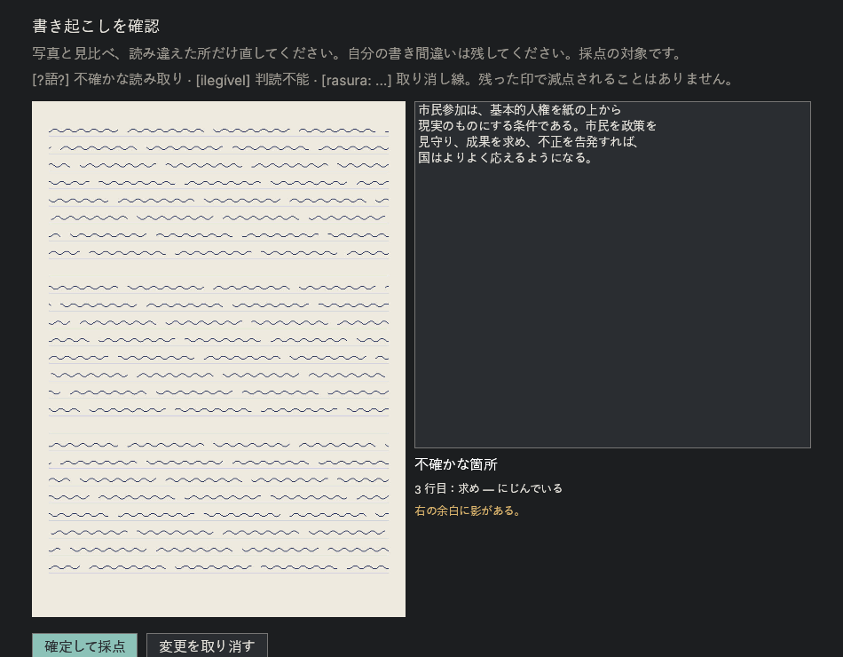</td>
    <td>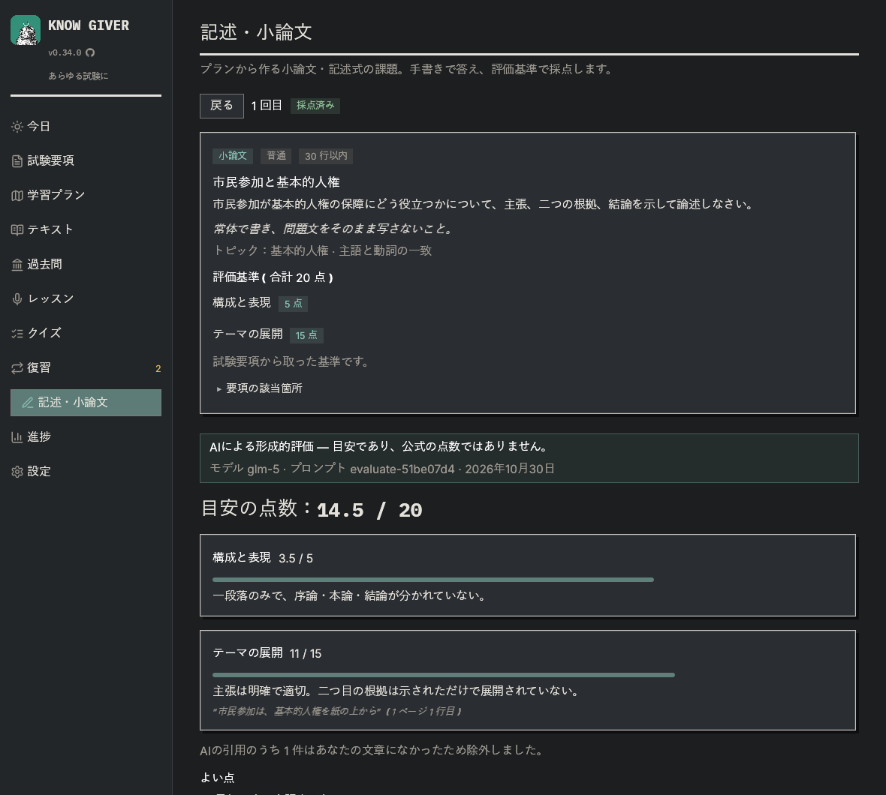</td>
  </tr>
</table>

<table>
  <tr>
    <td>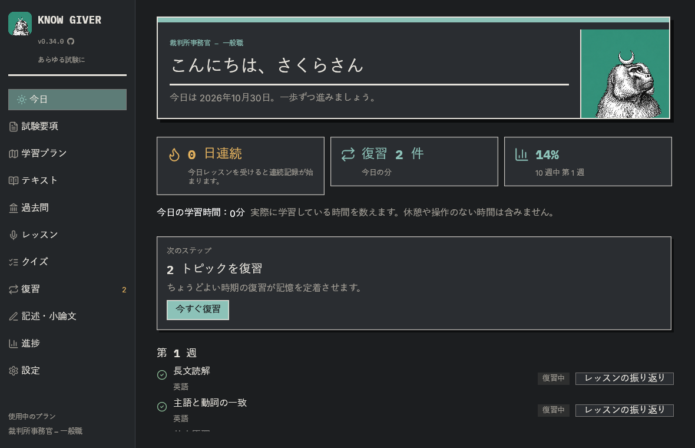</td>
    <td>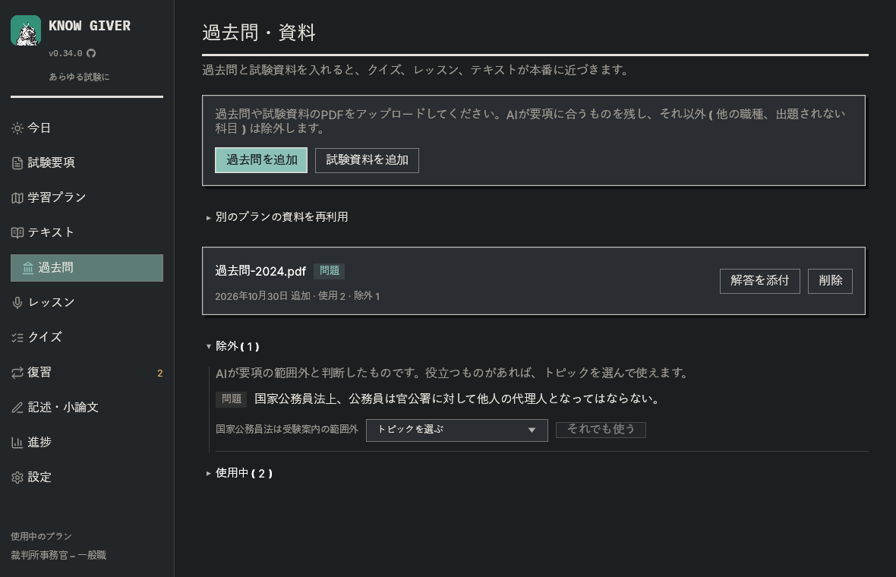</td>
  </tr>
</table>

## 初回設定

最初に5つの短いステップがあります：言語、名前、先生、AIとキー、国・地域と規約への同意。21のAI提供元から選べ（**Z.ai** はコスパ、**Claude** は正確さでおすすめ）、キーの作成ページへのリンクがあります。その後、画面を案内する短いツアーがあります。

**無料と有料。** AIのステップには2つのタブがあります。「有料」はおすすめのサービス（コスパの Z.ai、正確さの Claude）、「無料」は無料プランのあるサービス（Gemini、Mistral、OpenRouter、Groq、NVIDIA、GitHub Models、お使いのコンピューターで動く Ollama や LM Studio）です。それぞれ対象のモデル、送った内容の扱い（学習に使う無料プランもあります）、上限と規約へのリンクを表示します。

**地域の勉強のしかた。** レッスン、クイズ、テキスト、記述・小論文は、お住まいの地域の試験の勉強のしかたに合わせます。日本では五肢択一と字数で書く小論文、中国大陸では行测と申论、台湾と香港ではそれぞれの公務員試験の形式、ブラジルでは Cebraspe の正誤問題と5択、米国と英国では標準テスト、司法試験、採点基準（mark scheme）です。試験要項と過去問が常に優先されます。

<p align="center">
  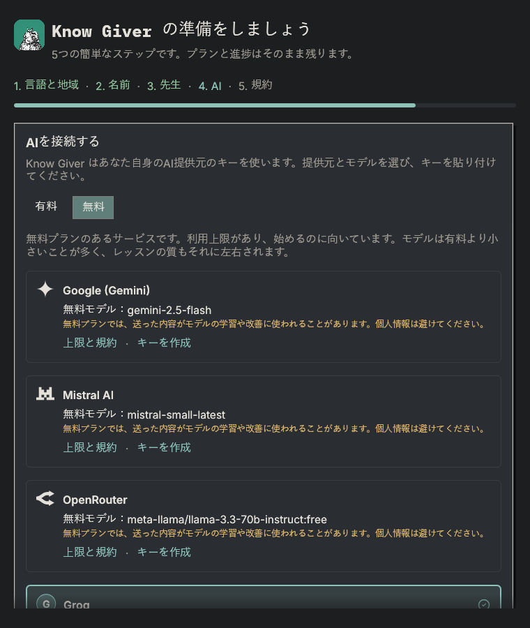
</p>

<table>
  <tr>
    <td>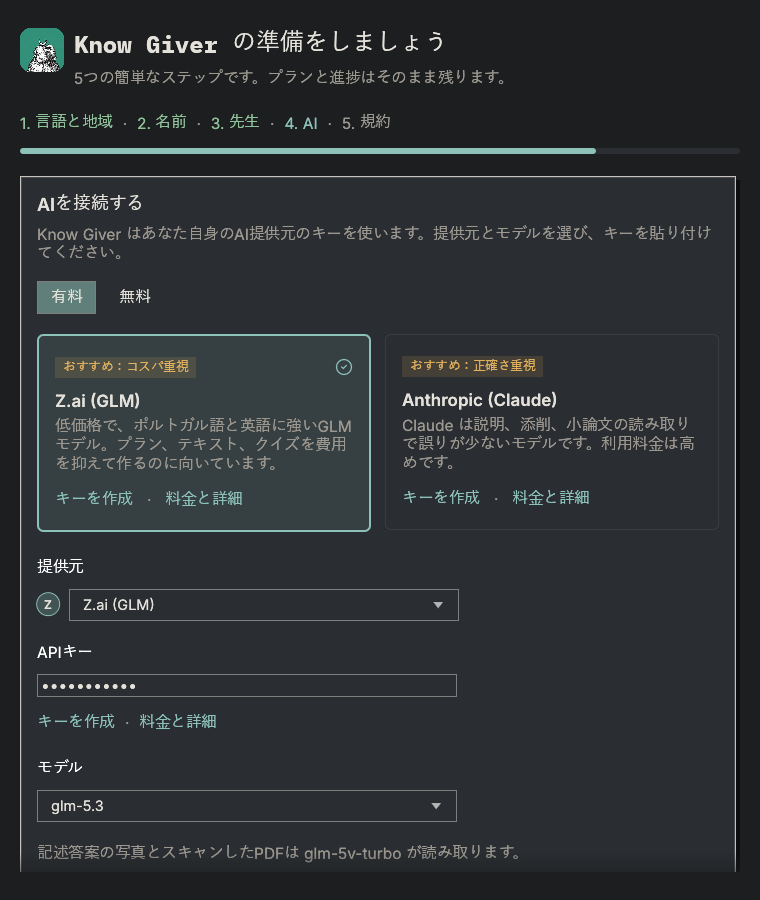</td>
    <td>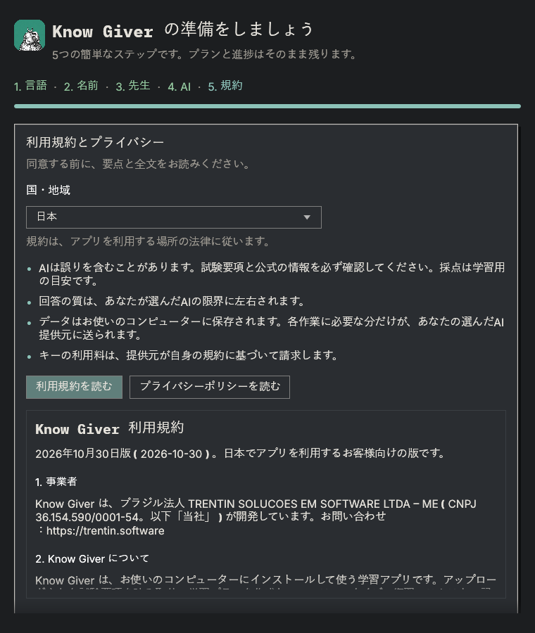</td>
  </tr>
</table>

<p align="center">
  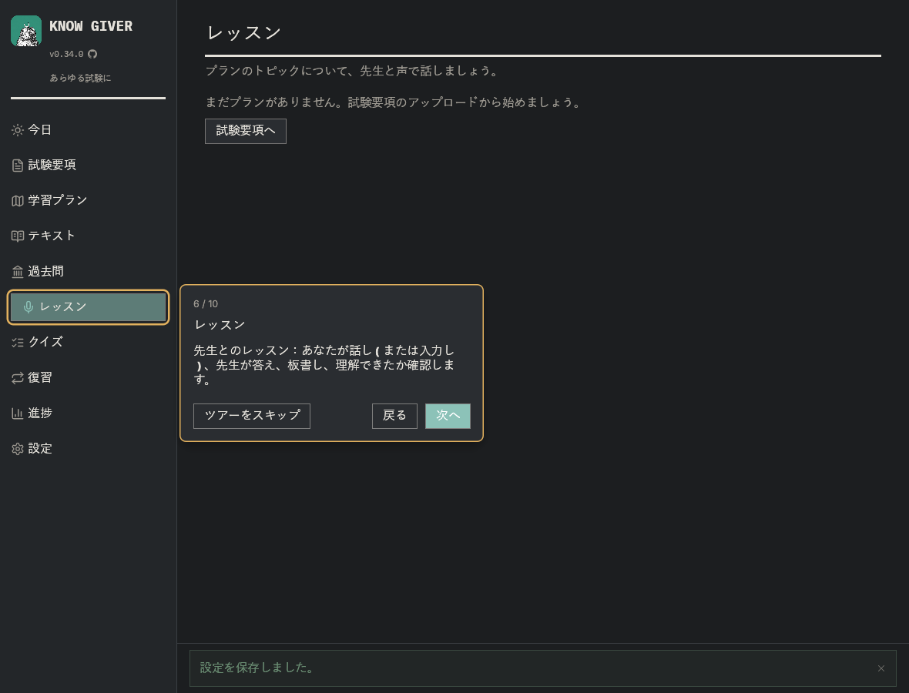
</p>

## プライバシー

- 音声認識と読み上げはお使いのコンピューターで動作し、録音は外に出ません。
- データ（SQLiteのデータベース、モデル、ログ）は `%LOCALAPPDATA%\KnowGiver` に保存されます。
- AIサービスには、作業に必要な文章だけが送られます。画像対応モデルを設定した場合に限り、答案の写真もそのモデルに送られます。
- 起動時に、最新のバージョンを GitHub に問い合わせます。送られるのはこの問い合わせだけで、設定 → アプリについて・アップデート でオフにできます。
- アカウント、テレメトリー、広告はありません。[利用規約](docs/legal/terms-of-use.ja.md)と[プライバシーポリシー](docs/legal/privacy-policy.ja.md)（日本法）をお読みください。アプリ内でも表示されます。

Know Giver は日本、ブラジル、アメリカ合衆国、欧州連合、イギリス、台湾、香港、シンガポールで一般に提供しています。その他の国・地域では、書面で認めたパートナーだけが[パートナーアクセス規約](docs/legal/partner-access.ja.md)に基づいて利用できます。

## インストール

各バージョンは [GitHub のリリース](https://github.com/czarist/know-giver/releases/latest) として公開され、Windows（x64）、macOS（Apple シリコン）、Linux（x86_64）のパッケージがあります。次のコマンドで最新版をダウンロードし、リリースのチェックサムで確認してから、管理者権限なしでお使いのユーザーにインストールします。プランと進捗はそのまま残ります。

**Windows**（PowerShell）：

```powershell
irm https://raw.githubusercontent.com/czarist/know-giver/main/scripts/install.ps1 | iex
```

**macOS**（ターミナル）：

```bash
curl -fsSL https://raw.githubusercontent.com/czarist/know-giver/main/scripts/install.sh | bash
```

**Linux**（ターミナル）：

```bash
curl -fsSL https://raw.githubusercontent.com/czarist/know-giver/main/scripts/install.sh | bash
```

インストール先は、Windows では `%LOCALAPPDATA%\Programs\KnowGiver`（スタートメニューに登録）、macOS では `~/Applications/Know Giver.app`、Linux では `~/.local/opt/KnowGiver`（`know-giver` コマンドとアプリメニューに登録）です。

初めてのインストールでは、**デスクトップのショートカット**を作るか確認します（アップデートでは前の選択を保ちます）。**アンインストール**は、Windows では 設定 → アプリ → Know Giver（スタートメニューの「Uninstall Know Giver」、プログラムフォルダーの `unins000.exe` でも可）、macOS では `"~/Applications/Know Giver.app/Contents/Resources/uninstall.sh"`、Linux では `~/.local/opt/KnowGiver/uninstall.sh` です。学習データも削除するか確認し、「はい」と答えない限り残します。

**アップデート：** 新しいバージョンが出ると、アプリの上部に細いバーが表示され、緑のダウンロードボタンで案内します。アプリがダウンロード・確認・インストールを行い、もう一度開きます。確認は 設定 → アプリについて・アップデート でオフにできます。

## はじめかた

```bash
cargo run --release
```

初回起動時に初回設定が開きます。Rust 1.95 以上が必要です。Windows 用のパッケージ：

```powershell
powershell -ExecutionPolicy Bypass -File scripts\package.ps1
```

開発については [English README](README.md#development) をご覧ください（技術文書は英語です）。

## ライセンス

[MIT](LICENSE-MIT) または [Apache License 2.0](LICENSE-APACHE) のいずれかを選んで利用できます（`MIT OR Apache-2.0`）。第三者のフォント、肖像、音声、ロゴはそれぞれのライセンスに従います（[English README の Credits](README.md#credits)）。脆弱性の報告は [SECURITY.md](SECURITY.md) をご覧ください。
