<p align="center">
  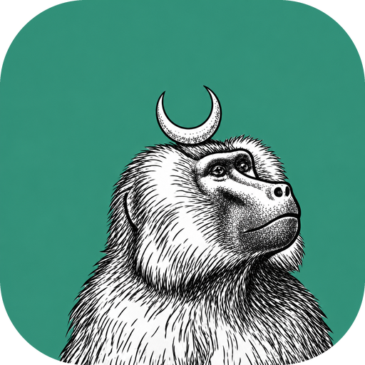
</p>

<h1 align="center">Know Giver</h1>

<h3 align="center">나의 시험. 나의 계획. 대화하는 선생님.</h3>

<p align="center">
  <a href="README.md">English</a> · <a href="README.pt-BR.md">Português (Brasil)</a> · <a href="README.ja.md">日本語</a> · <a href="README.ko.md">한국어</a> · <a href="README.zh-Hans.md">简体中文</a> · <a href="README.zh-Hant.md">繁體中文</a>
</p>

<p align="center">
  <b>시험 학습 계획을 만들어 주는 데스크톱 앱. 순수 Rust로 만들었습니다.</b><br>
  시험 공고문이나 출제 범위 PDF를 넣으면 주 단위 계획이 만들어지고, 내 말을 듣고 설명하고 문제를 내 주는 선생님과 함께 공부할 수 있습니다.
</p>

<p align="center">
  <a href="https://www.rust-lang.org"></a>
  <a href="https://github.com/emilk/egui"></a>
  <a href="https://www.sqlite.org"></a>
  <a href="https://typst.app"></a>
  <a href="https://huggingface.co/nvidia/nemotron-3.5-asr-streaming-0.6b"></a>
  <a href="https://github.com/rhasspy/piper"></a>
  
  
  <a href="https://github.com/ggml-org/llama.cpp"></a>
  
  
  
  
  <a href="#라이선스"></a>
  <a href="https://github.com/czarist/know-giver/tags"></a>
  
  
  <a href="https://github.com/czarist/know-giver/actions/workflows/packages.yml"></a>
</p>

<br>

<p align="center">
  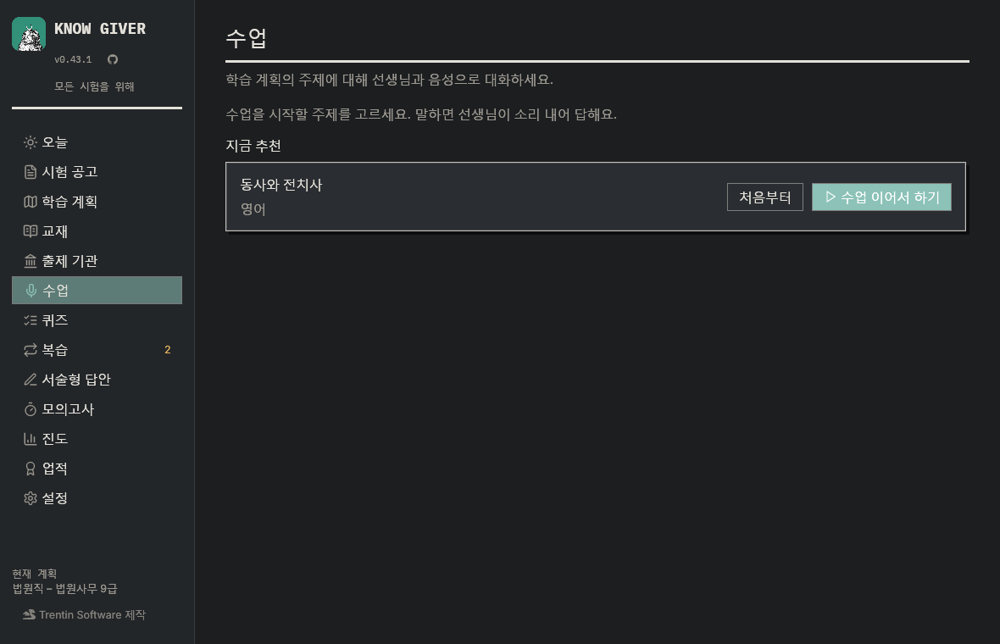
</p>

<p align="center">
  <a href="#시험-공고문에서-학습-계획까지">공고문 → 계획</a> ·
  <a href="#수업">수업</a> ·
  <a href="#칠판">칠판</a> ·
  <a href="#교재를-읽고-형광펜-긋기">교재</a> ·
  <a href="#연습복습교재">연습</a> ·
  <a href="#서술형논술">서술형·논술</a> ·
  <a href="#처음-설정">처음 설정</a> ·
  <a href="#개인정보-보호">개인정보 보호</a> ·
  <a href="#시작하기">시작하기</a>
</p>

<br>

## 시험 공고문에서 학습 계획까지

시험 공고문은 내 컴퓨터에서 읽히고, 출제 범위만 AI로 전송됩니다.

- **직렬 선택.** 여러 직렬을 함께 모집하는 시험도 있습니다. Know Giver가 직렬을 찾아 어느 직렬에 응시하는지 묻고, 계획에는 공통 과목과 *내* 직렬의 전공 과목만 넣습니다.
- **내 일정에 맞게.** 시험까지 남은 주 수와 주당 공부 시간에 맞춰 주·과목·주제별 계획을 만듭니다. 여러 시험을 나란히 관리할 수 있습니다.
- **스캔한 PDF.** 글자가 없는 페이지는 설정한 이미지 인식 모델로 받아쓸 수 있습니다.

<p align="center">
  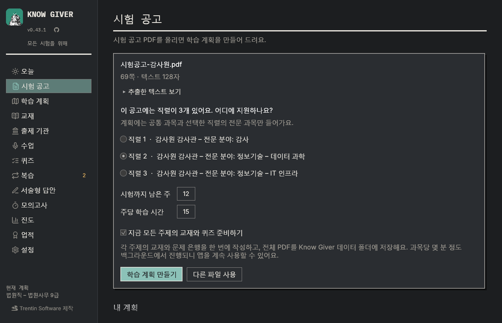
</p>

## 수업

선생님이 정해진 진행 순서에 따라 주제를 한 단계씩 가르칩니다. 단계마다 교재의 핵심 내용을 다루고, 이해했는지 확인한 뒤 다음으로 넘어가며, 퀴즈에서 물을 내용을 모두 짚습니다. 마지막에는 정리와 퀴즈 안내가 있습니다. 길이는 「짧게」「보통」「충분히」 중에서 고를 수 있습니다.

**한국어 수업은 현재 글로 주고받습니다.** 음성(로컬 음성 인식과 읽어 주기)은 지금은 포르투갈어와 영어를 지원합니다. 한국어 음성은 앞으로 지원할 예정입니다. 설정에서 클라우드 음성 서비스를 사용할 수는 있습니다.

메모리가 8 GB 이상인 컴퓨터에서는 포르투갈어 음성 인식에 **Nemotron 3.5**(NVIDIA)가 기본으로 쓰입니다. 8 GB 미만에서는 Parakeet가 그대로 기본입니다. 설정 → 「음성」에서 바꿀 수 있습니다. Nemotron은 언어를 추측하지 않고 지정된 언어로 인식하며, 첫 테스트에서 Parakeet 오류의 약 절반 정도만 냈습니다. NVIDIA 그래픽 카드에서는 CUDA, AMD와 Intel 카드에서는 Vulkan, 전용 카드가 없으면 CPU로 동작합니다.

음성 수업에서는 일시 정지(⏸)로 선생님 말을 문장 중간에 멈춰도 나머지가 사라지지 않고, 일시 정지 중에만 켜지는 재생(▶)으로 멈춘 곳부터 이어집니다.

AI는 OpenAI 호환 모델이라면 무엇이든 쓸 수 있으며(Z.ai, Anthropic, OpenAI, Gemini, Ollama 등), 선생님에게 주는 지시(프롬프트)는 앱 언어에 맞춰 한국어로 바뀝니다.

## 칠판

핵심 내용 외에도 선생님은 **공식**, **도식**, **비교표**, **연표**, **마인드맵**, **시험 포인트**, **예제**를 쓰고, Wikipedia의 **그림**도 보여 줍니다(컴퓨터 밖으로 나가는 것은 검색어뿐입니다).

<p align="center">
  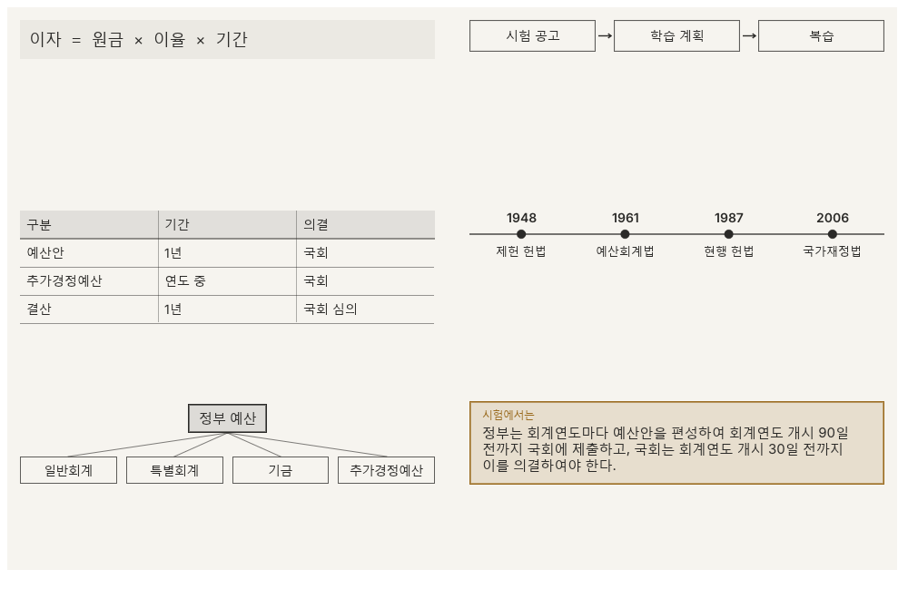
</p>

선생님은 네 명: **하은**, **리아**, **라온**, **오현**. 숨 쉬고, 눈을 깜빡이고, 고개를 끄덕이는 잉크 초상입니다.

<p align="center">
  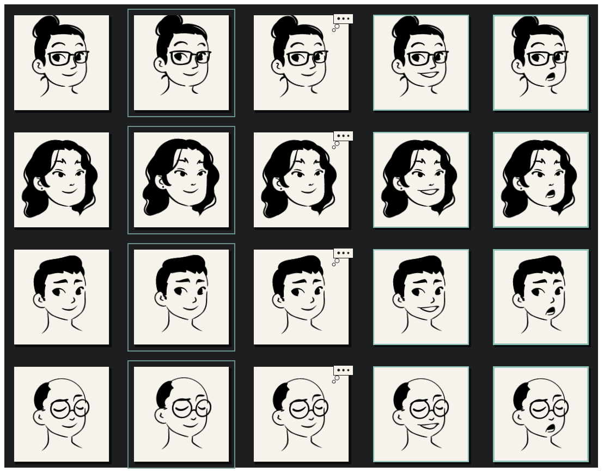
</p>

## 교재를 읽고 형광펜 긋기

만든 교재는 앱 안에서 PDF와 똑같은 페이지로 열립니다. 문장을 드래그해 형광펜을 긋고, 클릭해 메모를 남기고, 옆 목록에서 모든 형광펜 위치로 이동할 수 있습니다. 어디까지 읽었는지 기억하며, 형광펜이 들어간 PDF도 저장할 수 있습니다.

<p align="center">
  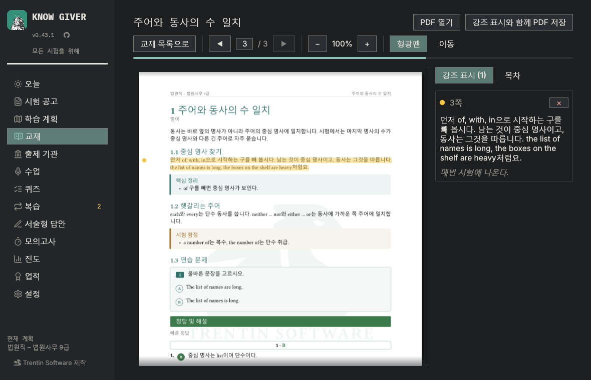
</p>

## 연습·복습·교재

- **퀴즈**: 시험 형식의 문제와 해설. 기출문제를 올리면 실제 문제도 나옵니다. 객관식 외에 Cebraspe식 O/X 문제(오답 하나가 정답 하나를 상쇄하는 채점)도 고를 수 있습니다.
- **오답 노트**: 틀린 문제는 맞힐 때까지 남아 있고, 다음 퀴즈에서 가장 먼저 나옵니다.
- **간격 반복 복습(SM-2)**: 잊어버리기 직전에 주제가 다시 돌아옵니다.
- **기출문제와 자료**: 기출문제(정답 포함)와 자료를 공고문에 비추어 골라내고, 제외한 것에는 이유를 보여 줍니다.
- **교재**: 주제, 과목, 계획 전체 단위로 그림, 연습 문제, 정답이 들어간 PDF로.
- **진도**: 과목별 진행 상황과 실제로 공부한 시간.

## 모의고사

공고문 형식 그대로의 시험을 시간을 재며 풉니다. **공고문에서 읽기**로 과목별 문항 수, 시험 시간, 객관식인지 O/X인지, 오답 감점, 논술 여부를 찾습니다. 숫자는 공고문 본문과 대조되며 모두 직접 조정할 수 있습니다. **모의고사 만들기**를 누르면 출제 기관의 스타일로 과목마다 새 문제를 계획의 주제 전체에서 만듭니다(추가한 기출문제가 스타일의 본보기가 됩니다). 서술형 시험이 있는 공고문이면 논술 과제도 함께 나옵니다.

**화면에서** 풀거나(시계는 오른쪽 위) **인쇄**합니다. PDF에는 2단 문제지, 줄 번호가 있는 논술 답안지, 네 모서리에 표시가 있는 답안지가 들어 있습니다. 종이로 풀었다면 표시한 답을 앱의 답안지에 옮겨 적고 제출합니다. 화면을 떠나거나 앱을 닫아도 시간은 흐르고, 동시에 진행할 수 있는 시험은 하나뿐입니다. 채점은 저장된 정답과 공고문의 배점으로 하는 단순한 계산으로, 과목별 정답·오답·빈칸, 걸린 시간, 시간 초과 여부를 보여 줍니다. 틀린 문제는 오답 노트로, 논술은 서술형·논술로 보내 사진을 찍어 채점하며, 정답과 해설은 그 아래에서 열 수 있습니다. 새로운 도전 과제도 10개 함께 열립니다.

<table>
  <tr>
    <td>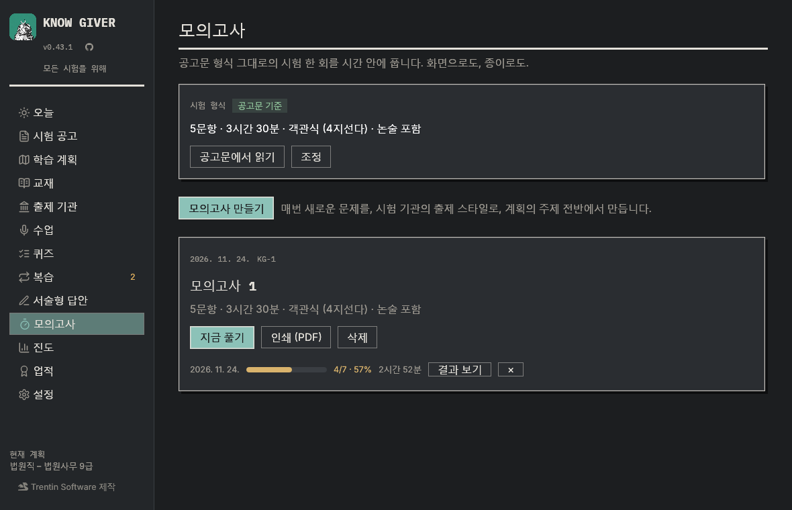</td>
    <td>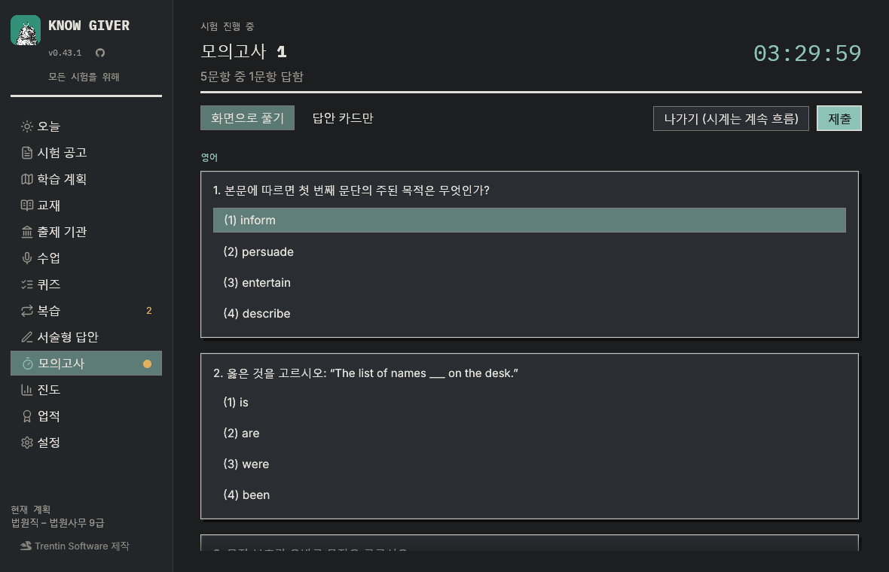</td>
    <td>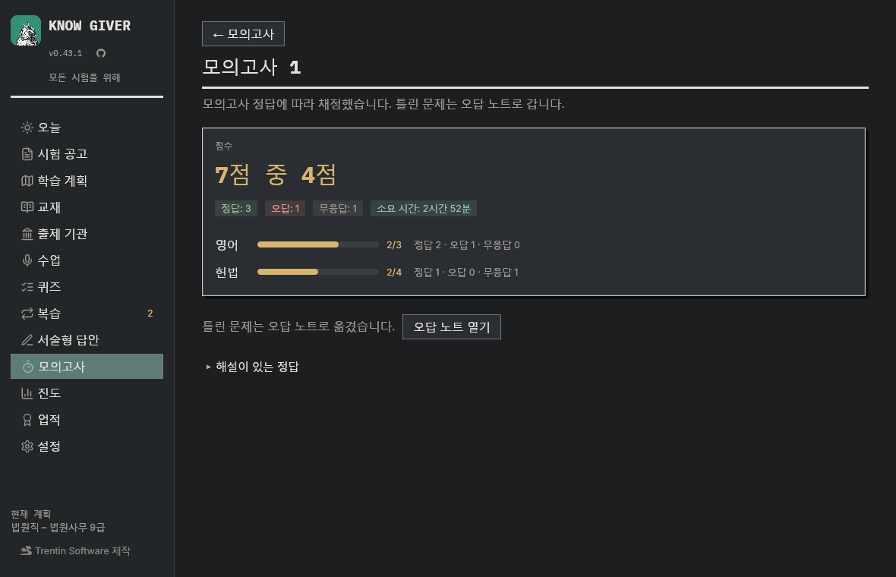</td>
  </tr>
</table>

## 도전 과제와 업적

**업적** 화면에는 36개 계열, **164개의 도전 과제**가 있고, 단계마다 고유한 업적 배지(비취색, 초승달, 앱 로고와 같은 판화풍)를 받습니다. 계획별로: 수업, 퀴즈, 정답과 만점, 되찾은 오답, 공부한 주제와 공고문 범위, 순조로운 주, 익힌 주제와 과목, 복습, 기출문제, 교재와 형광펜, 공고문에 있으면 서술형. 모든 계획 합계로: 공부 시간과 공부한 날, 만든 계획, 컬렉션 자체. 첫걸음·역전·움직이는 계획·순조로운 한 주에는 고유한 이름이 있습니다.

각 계열은 한 줄로, 다음 단계, 진행 정도(2/3), 「단계 3/11」, 수업·퀴즈·복습으로 가는 버튼을 보여 줍니다. 「오늘」 화면에는 다음 도전 과제가 조용히 표시됩니다. 진열장에는 모든 업적이 있으며, 획득·미획득으로 걸러 볼 수 있고 마우스를 올리면 자세한 내용이 나옵니다. 단계는 테두리 색과 1~3개의 점으로 나타냅니다. 업적은 저장된 학습 기록을 바탕으로 코드의 규칙으로만 주어지며 AI가 정하지 않습니다. 진행 상황은 계획마다 따로 관리됩니다. 이 기능이 생기기 전의 공부도 셈에 들어가며, 날짜를 알 수 없으면 카드에 그렇게 표시됩니다. 알림은 수업이나 퀴즈가 끝난 뒤 한 번만 나옵니다. 포인트도, 순위도, 끊기는 연속 기록도 없습니다.

<table>
  <tr>
    <td>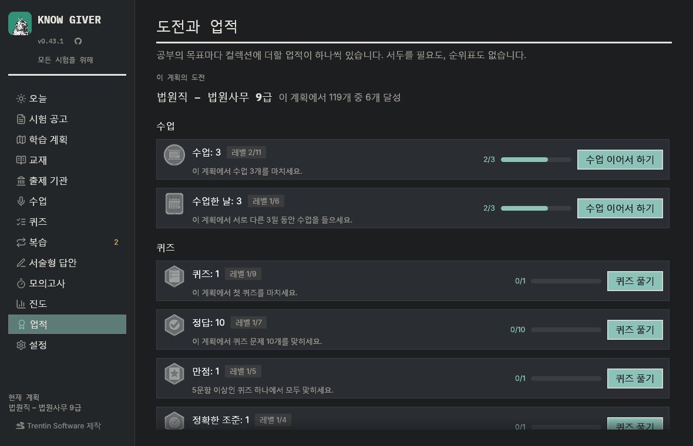</td>
    <td>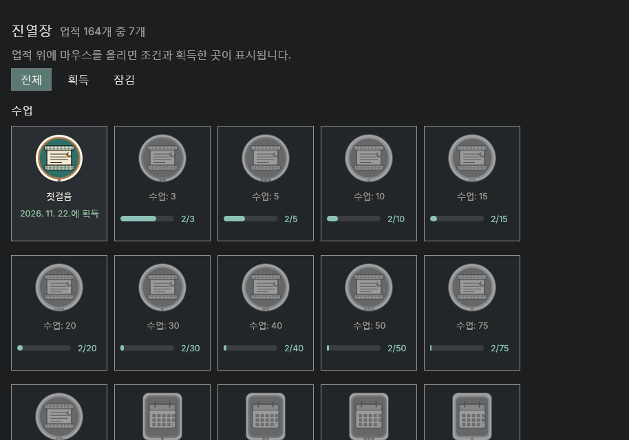</td>
  </tr>
</table>

**효과음과 축하.** 버튼 종류마다 다른, 부드럽고 낮은 인터페이스 소리. 정답에는 짧은 차임, 퀴즈나 수업을 마치거나 도전 과제를 달성하면 작은 팡파르와 색종이. 설정 → 「효과음과 애니메이션」에서 모두 끄거나 그룹별로(마우스 올리기, 버튼, 사이드바 등) 끌 수 있고, 애니메이션도 거기서 끌 수 있습니다. 마이크가 듣는 동안에는 소리가 나지 않습니다.

## 서술형·논술

시험 공고문에 논술이나 서술형 시험이 있으면 **서술형·논술** 화면이 나타납니다.

- **계획에서 과제 만들기**: 논술, 전공 서술형 문제, 사례형 문제. 평가 기준과 배점은 쓰기 전에 보여 줍니다(공고문에 있는 것, 내가 정한 것, Know Giver의 일반 기준 중 하나).
- **손으로 쓰고 사진 보내기**: JPEG 또는 PNG. 어둡거나 흐리거나 잘린 사진은 다시 찍어 달라고 요청합니다.
- **인식 결과 확인**: 사진과 받아쓴 글을 나란히 보여 줍니다. 내가 쓴 맞춤법과 실수는 그대로 남고, 불확실한 단어 때문에 감점되지는 않습니다.
- **형성 평가 채점**: 기준별 예상 점수, 본문에서 확인된 인용, 잘한 점, 문제점과 개선안, 우선해야 할 세 가지.

기본적으로 PaddleOCR-VL 1.5(0.9B)가 사진을 로컬에서 읽습니다. 함께 제공되는 [🦙 llama.cpp](https://github.com/ggml-org/llama.cpp)의 `llama-server` v0.8.0을 사용하며, 처음에 Hugging Face에서 모델 약 1.82 GB를 내려받습니다. 설정 → AI에서 외부 이미지 인식 API를 직접 선택하면 사진은 그 제공업체로 전송됩니다. Copilot은 텍스트 전용이라 항상 로컬 OCR을 사용합니다. **이미지 읽기 테스트**로 선택한 방식을 확인할 수 있습니다. 최소 하드웨어 사양과 손글씨 인식 정확도는 아직 검증되지 않았습니다. 채점 전에 받아쓴 글을 꼭 확인하세요. 음성 인식과 마찬가지로 전용 그래픽 카드에 맞춰 빌드를 고릅니다. NVIDIA에서는 CUDA(llama.cpp 공식 CUDA 빌드, 약 590 MB, 모델과 함께 또는 나중에 같은 화면에서 다운로드), AMD와 Intel Arc에서는 🔺 [Vulkan](https://www.vulkan.org/)(Windows와 Linux 빌드에 포함), 전용 카드가 없으면 CPU를 사용합니다. GPU 빌드가 시작되지 않으면 다음 빌드로, 마지막에는 CPU로 넘어갑니다. macOS는 CPU를 사용합니다.
Windows 설치 프로그램에는 필요한 C++ 런타임과 Vulkan 로더가 들어 있습니다. Vulkan을 쓰려면 호환되는 GPU 드라이버가 따로 필요합니다.

<table>
  <tr>
    <td>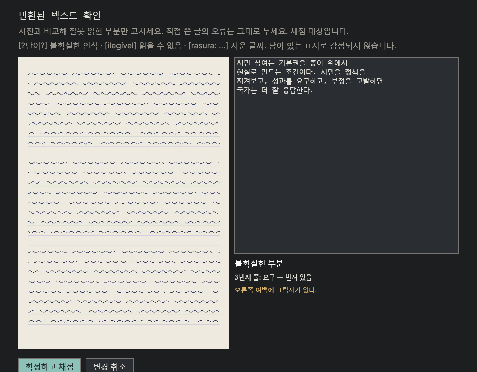</td>
    <td>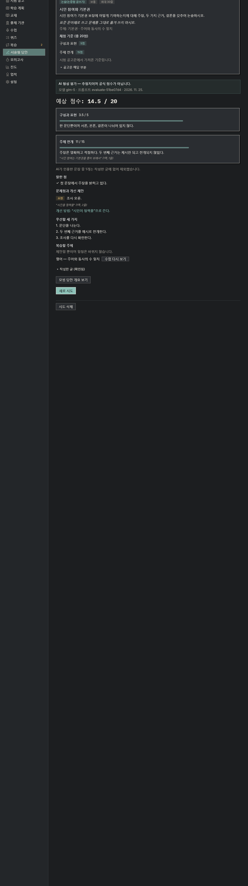</td>
  </tr>
</table>

<table>
  <tr>
    <td>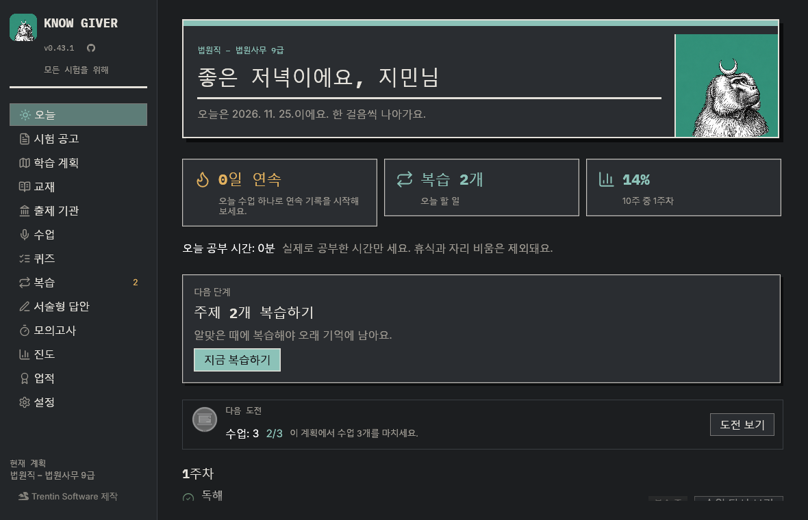</td>
    <td>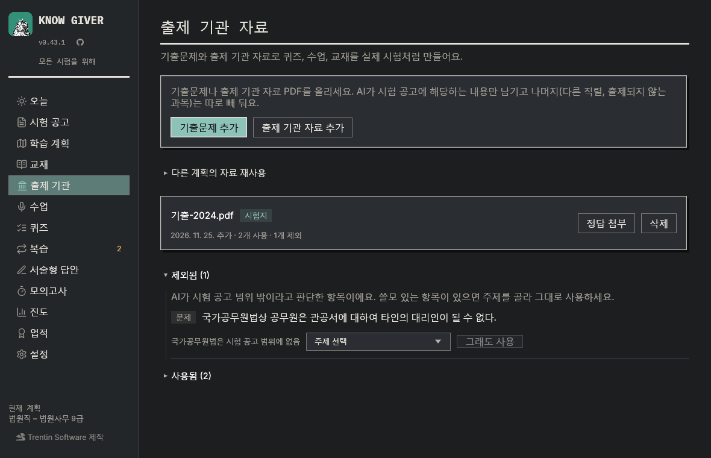</td>
  </tr>
</table>

## 처음 설정

맨 처음에 짧은 다섯 단계가 있습니다: 언어, 이름, 선생님, AI와 API 키 또는 계정 로그인, 국가·지역과 약관 동의. 22개 AI 제공업체 중에서 고를 수 있으며(**Z.ai**는 가성비, **Claude**는 정확도로 추천), 키 발급 페이지로 가는 링크가 있습니다. 그다음 화면을 안내하는 짧은 둘러보기가 이어집니다.

GitHub Copilot은 공식 Copilot CLI를 통해 GitHub 계정으로 연결할 수 있으며 API 키가 필요 없습니다. CLI는 보통 로그인 정보를 운영체제의 키체인에 저장합니다. 키체인을 쓸 수 없으면 평문 설정 파일(`~/.copilot/config.json`)에 저장할 수 있습니다. Know Giver는 데이터베이스에 로그인 정보를 저장하지 않습니다. 이 연동은 텍스트만 받으며 이미지는 지원하지 않습니다.

**이미 가진 계정으로 로그인.** AI 단계는 「계정으로 로그인」으로 시작합니다. 채팅 요금제를 쓰고 있지만 API 키를 만들어 본 적이 없는 분을 위한 것입니다. **ChatGPT**(OpenAI 공식 「Sign in with ChatGPT」. 수업은 ChatGPT 요금제 사용량에 포함됩니다), **Claude**(Anthropic 공식 프로그램 Claude Code를 통해 Claude Pro 또는 Max 계정으로. Know Giver가 설치해 줄 수도 있습니다), **GitHub Copilot**을 지원합니다. 로그인은 각 제공업체의 페이지에서 이루어지며, Know Giver는 비밀번호를 볼 수 없습니다. Know Giver는 OpenAI, Anthropic, GitHub와 제휴 관계가 아닙니다.

<p align="center">
  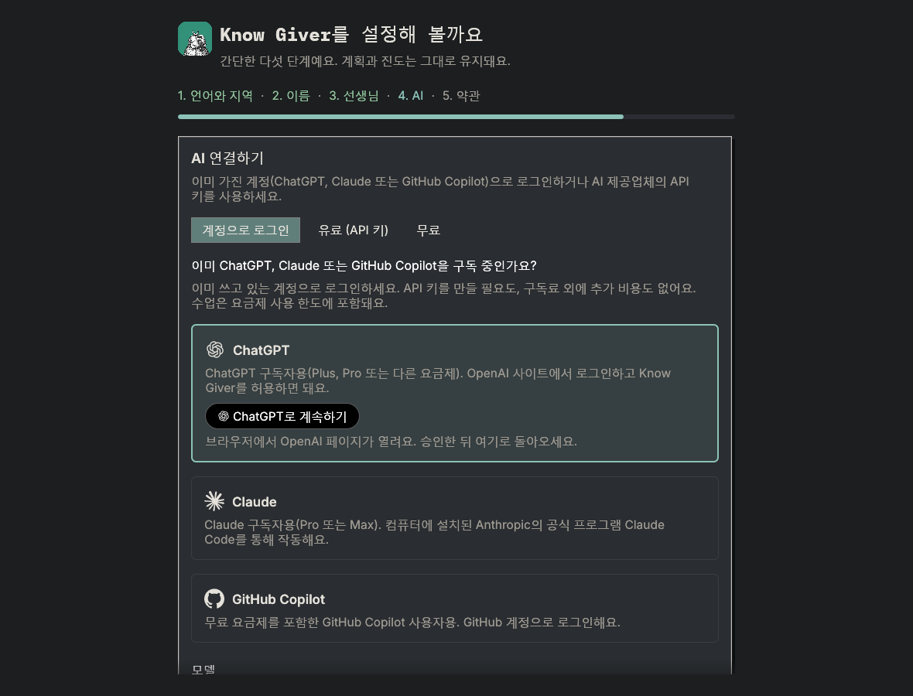
</p>

**무료와 유료.** 「계정으로 로그인」 외에도 AI 단계에는 탭이 두 개 더 있습니다. 「유료」는 추천 서비스(가성비의 Z.ai, 정확도의 Claude)를, 「무료」는 무료 요금제가 있는 서비스(Gemini, Mistral, OpenRouter, Groq, NVIDIA, GitHub Models, 내 컴퓨터에서 돌아가는 Ollama나 LM Studio)를 보여 줍니다. 각각 해당 모델, 보낸 내용을 어떻게 다루는지(학습에 쓰는 무료 요금제도 있습니다), 한도와 약관 링크를 표시합니다.

**지역에 맞는 공부 방식.** 수업, 퀴즈, 교재, 서술형·논술은 내가 사는 지역의 시험 준비 방식을 따릅니다. 한국에서는 공무원 시험의 4지선다, 수능의 5지선다와 논술, 일본에서는 5지선다와 글자 수로 쓰는 小論文, 중국 대륙에서는 行测와 申论, 대만과 홍콩에서는 각 공무원 시험의 형식, 브라질에서는 Cebraspe의 O/X 문제와 5지선다, 미국과 영국에서는 표준화 시험, 변호사 시험, 채점 기준(mark scheme)입니다. 시험 공고문과 기출문제가 항상 우선입니다.

<p align="center">
  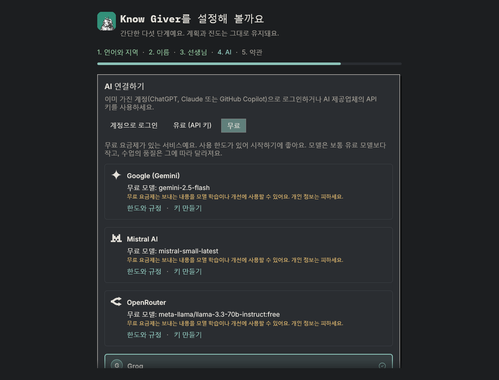
</p>

<table>
  <tr>
    <td>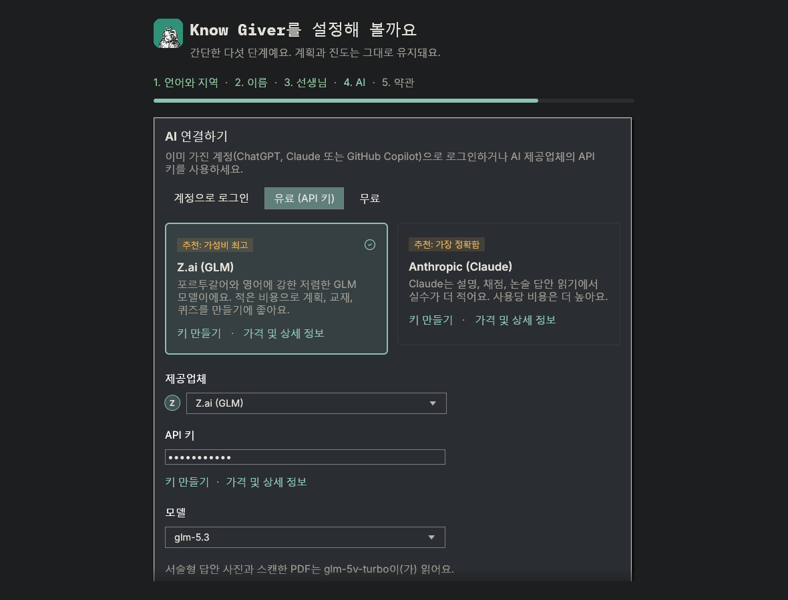</td>
    <td>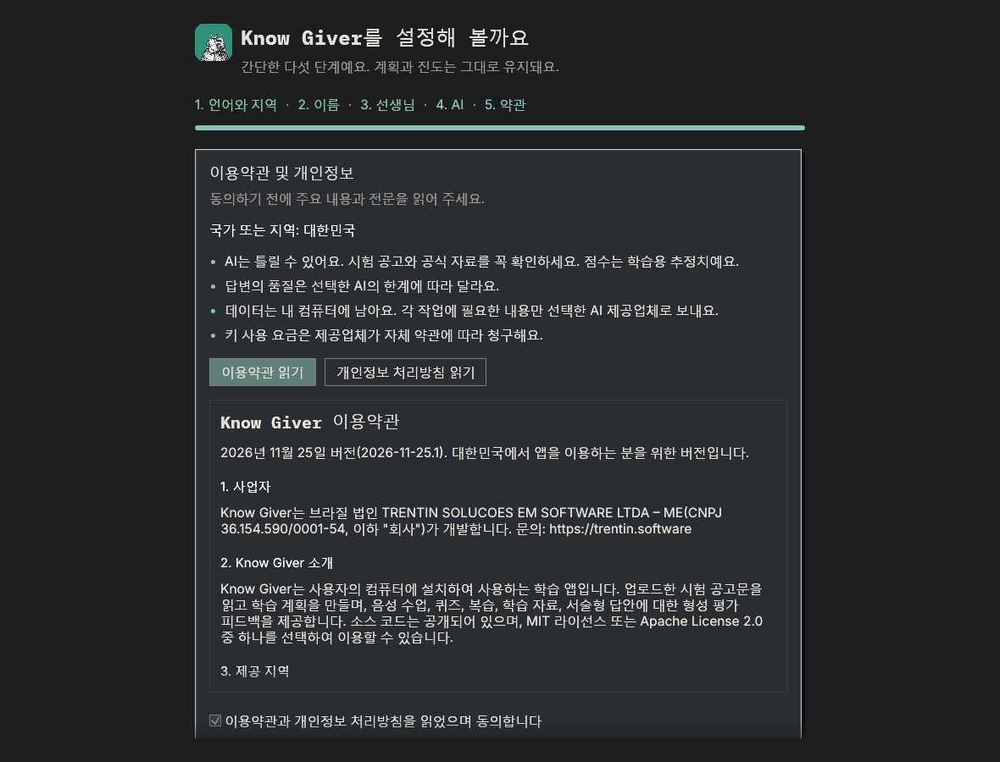</td>
  </tr>
</table>

<p align="center">
  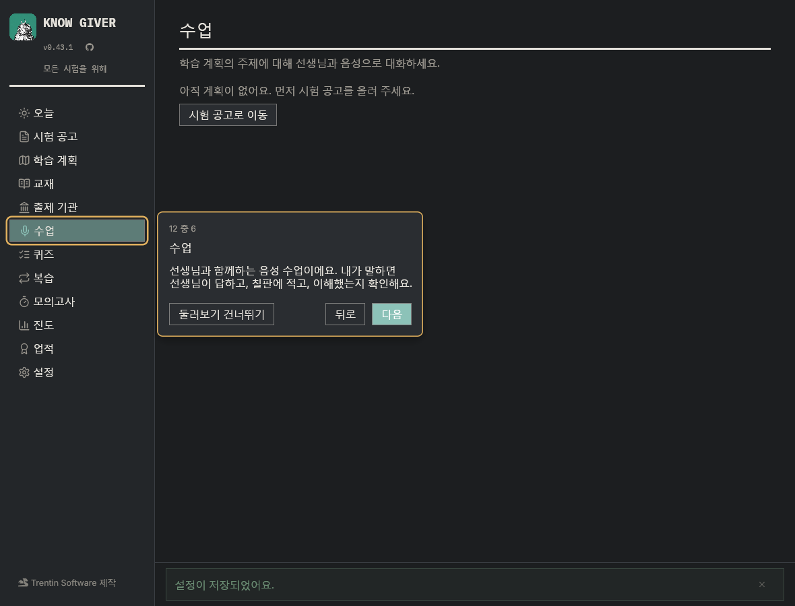
</p>

**다른 컴퓨터로 옮기기.** 설정 → 「다른 컴퓨터로 옮기기」에서 계획, 학습 기록, 교재, 서술형 답안, 설정을 `.kgbackup` 파일 하나에 저장합니다. 새 컴퓨터에서는 처음 설정의 첫 화면(「백업 가져오기」)이나 설정에서 엽니다. AI 서비스, 키, 모델, 연결한 계정은 파일에 들어가지 않으므로 AI만 설정하면 됩니다. 가져오면 그 컴퓨터의 학습 내용이 바뀌며, 그 전에 기존 내용의 사본을 앱 데이터의 `backups` 폴더에 보관합니다.

**수업 중.** 헤드폰 버튼으로 수업을 멈추지 않고 마이크와 소리(예: 헤드셋)를 바꿀 수 있습니다. 설정 → 「마이크와 소리」에서 선택이 저장됩니다. 칠판은 수업에서 쓴 내용을 모두 남기고, 화살표로 이전 내용을 볼 수 있으며, 코드는 줄 번호와 구문 색상이 있는 어두운 패널에 보여 줍니다. 영어 용어는 선생님 자신의 목소리로 읽히고 쓰인 그대로 표시됩니다. 채팅에서 컬러 이모지를 쓸 수 있고, Teams처럼 선생님의 말에 반응할 수 있습니다(👍 ❤️ 😂 😮 😕 🙏). 선생님은 반응과 기분을 읽고, 😕에는 다른 설명으로 답합니다.

**나의 학습 선호.** 선생님은 당신이 배우는 방식(실제 예시, 느린 속도, 어려워하는 부분)을 메모하고 매 수업 시작 때 읽습니다. 메모는 텍스트 파일이며 설정 → 「나의 학습 선호」나 어떤 편집기에서도 고칠 수 있고, 직접 쓴 내용이 우선합니다. 이 컴퓨터에 저장되고, 수업과 함께 AI로 전송되며, 백업에도 포함됩니다. 기본으로 켜져 있으며 같은 곳에서 끌 수 있습니다.

## 개인정보 보호

- 음성 인식과 읽어 주기는 내 컴퓨터에서 동작하며, 녹음은 밖으로 나가지 않습니다.
- 데이터(SQLite 데이터베이스, 모델, 로그)는 `%LOCALAPPDATA%\KnowGiver`에 저장됩니다.
- 손글씨 사진은 기본적으로 로컬에서 읽으며 이 컴퓨터를 떠나지 않습니다. 설정 → AI에서 외부 이미지 인식 API를 직접 선택한 경우에만 사진이 제공업체로 전송됩니다. Copilot은 항상 로컬 OCR을 사용합니다. 전송 전에 앱이 어디로 보내는지 보여 줍니다. 사진은 데이터 폴더에 저장되고 답안을 지우면 함께 지워집니다. 스캔 PDF 페이지는 OCR을 요청한 경우에만 설정된 이미지 인식 모델로 전송됩니다. 로컬 OCR을 처음 설치할 때 Hugging Face에서 약 1.82 GB를 내려받습니다.
- 실행할 때 최신 버전을 GitHub에 확인합니다. 보내는 것은 이 요청뿐이며, 설정 → 앱 정보 및 업데이트에서 끌 수 있습니다.
- 계정, 원격 측정(텔레메트리), 광고가 없습니다. [이용약관](docs/legal/terms-of-use.ko.md)과 [개인정보 처리방침](docs/legal/privacy-policy.ko.md)(대한민국 법)을 읽어 주세요. 앱 안에서도 볼 수 있습니다.

Know Giver는 대한민국, 일본, 브라질, 미국, 유럽연합, 영국, 대만, 홍콩, 싱가포르에서 일반에 제공됩니다. 그 밖의 국가·지역에서는 서면으로 승인한 파트너만 [파트너 이용 약관](docs/legal/partner-access.ko.md)에 따라 사용할 수 있습니다.

## 설치

각 버전은 [GitHub 릴리스](https://github.com/czarist/know-giver/releases/latest)로 공개되며, Windows(x64), macOS(Apple 실리콘), Linux(x86_64) 패키지가 있습니다. 아래 명령 하나로 최신 버전을 내려받아 릴리스의 체크섬으로 확인한 뒤, 관리자 권한 없이 내 사용자 계정에 설치합니다. 계획과 진도는 그대로 남습니다.

**시스템 요구 사항:** 메모리 8 GB 이상이 필요합니다. 권장 사양은 16 GB와 4 GB 전용 그래픽 카드입니다. 8 GB 이상에서는 음성 인식에 Nemotron을 사용합니다(2 GB 이상의 전용 카드가 있으면 NVIDIA는 CUDA, AMD와 Intel은 Vulkan, 없으면 CPU). 8 GB 미만에서는 Parakeet를 사용합니다. 음성과 음성 인식 모델용으로 약 2 GB의 디스크 공간이 필요하며, 처음 사용할 때 내려받습니다.

**Windows**(PowerShell):

```powershell
irm https://raw.githubusercontent.com/czarist/know-giver/main/scripts/install.ps1 | iex
```

**macOS**(터미널):

```bash
curl -fsSL https://raw.githubusercontent.com/czarist/know-giver/main/scripts/install.sh | bash
```

**Linux**(터미널):

```bash
curl -fsSL https://raw.githubusercontent.com/czarist/know-giver/main/scripts/install.sh | bash
```

설치 위치는 Windows에서는 `%LOCALAPPDATA%\Programs\KnowGiver`(시작 메뉴에 등록), macOS에서는 `~/Applications/Know Giver.app`, Linux에서는 `~/.local/opt/KnowGiver`(`know-giver` 명령과 애플리케이션 메뉴에 등록)입니다.

Claude Code가 설치되어 있지 않으면, 첫 설치 때 Anthropic 공식 설치 프로그램으로 Claude Code도 함께 설치할지 묻습니다. Claude 구독을 쓰기 위한 것이며, 나중에 AI 단계에서 설치할 수도 있습니다.

첫 설치 때 **바탕화면 바로가기**를 만들지 묻습니다(업데이트할 때는 이전 선택을 유지합니다). **제거**는 Windows에서는 설정 → 앱 → Know Giver(시작 메뉴의 「Uninstall Know Giver」나 프로그램 폴더의 `unins000.exe`도 가능), macOS에서는 `"~/Applications/Know Giver.app/Contents/Resources/uninstall.sh"`, Linux에서는 `~/.local/opt/KnowGiver/uninstall.sh`입니다. 학습 데이터도 지울지 묻고, 「예」라고 답하지 않으면 남겨 둡니다.

**업데이트:** 새 버전이 나오면 앱 위쪽에 얇은 막대가 나타나 초록색 다운로드 버튼으로 안내합니다. 앱이 내려받기·확인·설치를 마친 뒤 다시 열립니다. 확인 기능은 설정 → 앱 정보 및 업데이트에서 끌 수 있습니다.

## 시작하기

```bash
cargo run --release
```

처음 실행하면 처음 설정이 열립니다. Rust 1.95 이상이 필요합니다. Windows용 패키지:

창을 닫으면 앱은 시스템 트레이에 남습니다. 아이콘을 두 번 클릭하면 다시 열리고, 한 번 클릭하면 메뉴(열기·종료)가 나옵니다. 실행 중에 Know Giver를 다시 열면 같은 창이 나타나며, 앱과 트레이 아이콘은 항상 하나뿐입니다. 설치할 때 시스템 시작 시 자동 실행과 학습 알림(기본 3시간마다, 설정에서 30분~8시간)을 고를 수 있습니다(둘 다 처음에는 꺼져 있음). 알림은 화면 구석에 나타나는 작은 Know Giver 창으로, 가장 뒤처진 과목과 공부 시작 버튼을 보여 줍니다. 알림은 앱을 떠나 있는 동안(트레이, 최소화, 다른 창 뒤)에만 나오며, 수업·퀴즈·복습 중에는 나오지 않고, 현재 계획에 끝나지 않은 과목이 있을 때만 표시됩니다.

```powershell
powershell -ExecutionPolicy Bypass -File scripts\package.ps1
```

개발에 관해서는 [English README](README.md#development)를 참고하세요(기술 문서는 영어입니다).

## 라이선스

[MIT](LICENSE-MIT) 또는 [Apache License 2.0](LICENSE-APACHE) 중 하나를 골라 사용할 수 있습니다(`MIT OR Apache-2.0`). 제3자의 글꼴, 초상, 음성, 로고는 각자의 라이선스를 따릅니다([English README의 Credits](README.md#credits)). 보안 취약점 신고는 [SECURITY.md](SECURITY.md)를 참고하세요.
