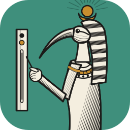
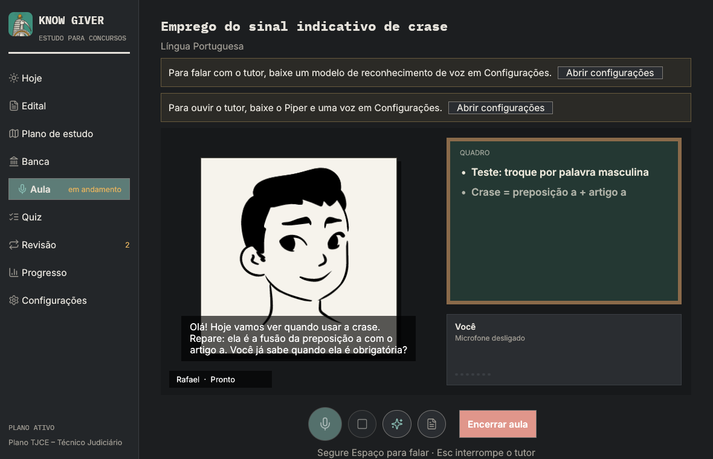
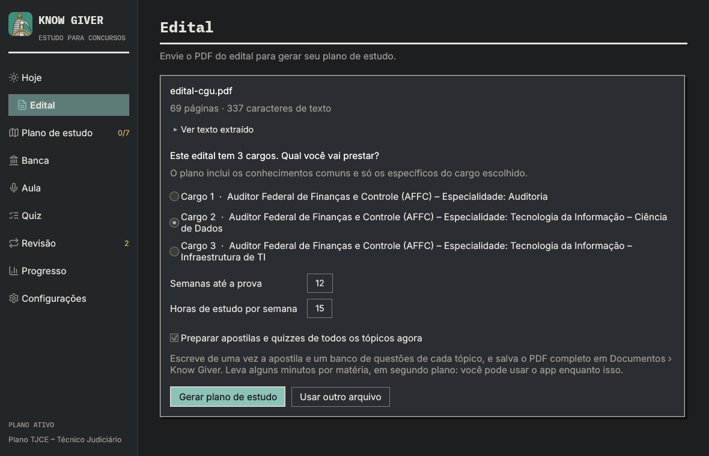
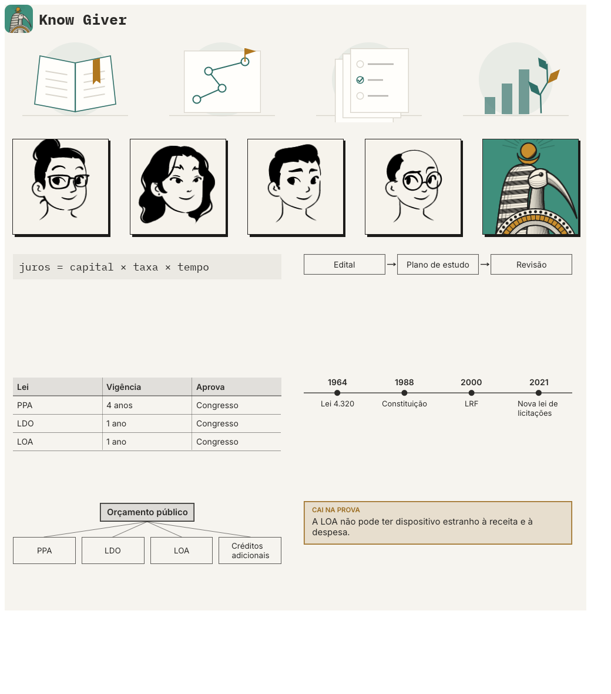
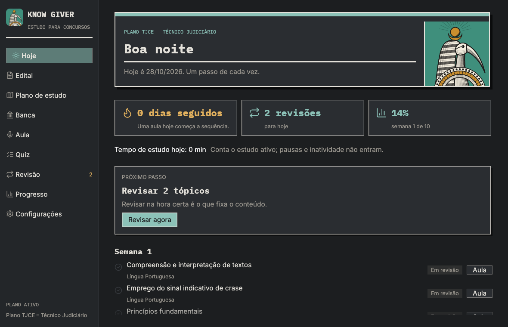
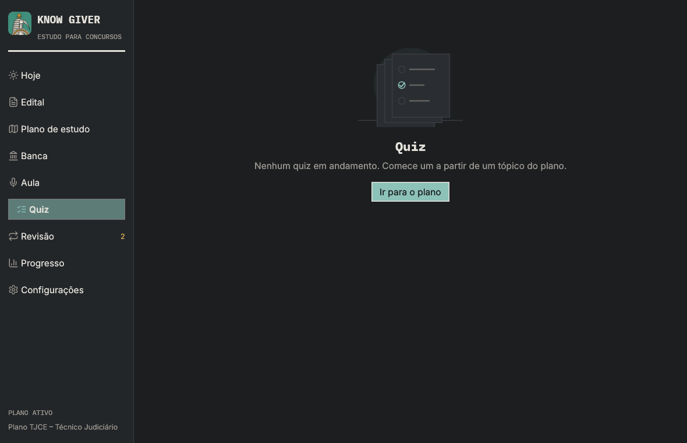

<p align="center">
  
</p>

<h1 align="center">Know Giver</h1>

<h3 align="center">Your edital. Your plan. A teacher who talks back.</h3>

<p align="center">
  <b>A desktop study companion for Brazilian public exams (concursos), built in pure Rust.</b><br>
  Drop in the edital PDF, get a week-by-week plan, and study out loud with a tutor that listens, explains and quizzes you.
</p>

<p align="center">
  
  
  
  
  
</p>

<br>

<p align="center">
  
</p>

<p align="center">
  <a href="#from-edital-to-plan">Edital → plan</a> ·
  <a href="#voice-lessons">Voice lessons</a> ·
  <a href="#a-whiteboard-that-shows-not-just-tells">Whiteboard</a> ·
  <a href="#teachers--voices">Teachers</a> ·
  <a href="#practice-review-handouts">Practice</a> ·
  <a href="#private-by-default">Privacy</a> ·
  <a href="#quick-start">Quick start</a> ·
  <a href="#development">Development</a>
</p>

<br>

## From edital to plan

The edital is read on your machine; only its syllabus goes to the AI.

- **Pick your role.** Editais often cover several cargos. Know Giver finds them
  ("CARGO 2: …") and asks which one you are applying for, so the plan has the shared
  subjects plus only *your* role's specific ones.
- **Your schedule.** Number of weeks and hours per week shape a plan by week, subject
  and topic. Keep several editais side by side.
- **Scanned PDFs.** Pages without text can be transcribed by a vision model you configure.

<p align="center">
  
</p>

## Voice lessons

You speak, the tutor answers out loud, like a call with a patient teacher.

### 🎙️ Listening
Local speech recognition: **Parakeet** for live captions while you talk, **Whisper**
as a second opinion on short or doubtful answers. The microphone stays open for the
whole lesson, soft voices are brought up before recognition, and your turn ends when
your sentence does.

### 🗣️ Speaking
The tutor starts talking with the first sentence of its answer, says "Hum." while it
thinks, and stops when you interrupt. Hands-free, push-to-talk (Space) or typing.

### 🧠 Teaching
Any OpenAI-compatible model (Ollama, LiteLLM, GLM, …) behind tutor prompts written in
spoken Brazilian Portuguese: short turns, one idea at a time, questions back to you.

## A whiteboard that shows, not just tells

Besides key points, the tutor writes **formulas**, **diagrams**, **comparison tables**,
**timelines**, **mind maps**, **"on the exam" tips**, **worked examples**, and puts up
**pictures** from Wikipedia (only the search term leaves your computer).

<p align="center">
  
</p>

## Teachers & voices

Choose who teaches: **Helena**, **Lia**, **Rafael**, **Otávio** or **Thoth** himself.
Ink portraits that breathe, blink, nod while you talk and move their lips with the voice:
human enough to talk to, drawn enough to stay out of the uncanny valley.

Ten voices, half of them female, from **Piper** and **Kokoro**, all running locally.

<p align="center">
  
</p>

## Practice, review, handouts

- **Quizzes** in the style of the exam boards, with explanations; real past questions
  when you upload past exams.
- **Spaced review (SM-2)**: topics come back right before you would forget them.
- **Exam board material**: past exams, answer keys and handouts, filtered against your
  edital, with the reason for whatever is set aside.
- **Handouts** per topic, subject or plan, exported to PDF.
- **Progress** per subject and **daily study time** that only counts active study.

<table>
  <tr>
    <td></td>
    <td></td>
  </tr>
</table>

## Private by default

- Speech recognition and the voices run on your machine. Recordings never leave it.
- Your data (SQLite database, models, log) lives in `%LOCALAPPDATA%\KnowGiver`, or in
  `KG_DATA_DIR` when set.
- Only text goes to the AI service you configure, and only what the task needs.

## Quick start

```bash
cp .env.example .env      # then fill in OPENAI_API_KEY (or set it in Settings)
cargo run --release
```

`.env` overrides global variables with the same name. On first use, download the speech
models in Settings. Rust 1.95 or newer.

**Windows package:**

```powershell
powershell -ExecutionPolicy Bypass -File scripts\package.ps1
```

Creates `dist\KnowGiver-<version>-windows-x64.zip`, plus an installer when
[Inno Setup 6](https://jrsoftware.org/isinfo.php) is installed.

## Development

```
crates/
  app/      # know-giver binary (entry point, icon)
  ui/       # egui interface (screens, theme, translations)
  engine/   # app state, commands, background work, voice loop
  study/    # plans, reviews (SM-2), quizzes, SQLite storage
  ai/       # OpenAI-compatible client + tutor prompts (crates/ai/prompts)
  audio/    # mic capture, Parakeet/Whisper STT, Piper/Kokoro TTS, playback, downloads
  pdf/      # edital text extraction, roles
  handout/  # study handouts rendered to PDF with Typst
locales/    # UI translations (pt-BR, en)
tools/      # artwork generators (icon, teacher portraits)
```

Dependencies point one way: `app → ui → engine → {study, ai, audio, pdf, handout}`.
See [docs/architecture.md](docs/architecture.md).

```bash
cargo fmt
cargo clippy --workspace --all-targets -- -D warnings
cargo test --workspace
```

Manual checks against real services (need `.env` and network):

```bash
cargo run -p kg-ai --example live_check                          # every AI task
cargo run -p kg-engine --example e2e -- edital.pdf                # import → plan → quiz → review → handout
cargo run --release -p kg-audio --example parakeet_check -- <models-dir> fala.wav
KG_SNAPSHOT_DIR=shots cargo test -p kg-ui snapshots -- --ignored  # renders every screen to PNG
```

More: [native/CUDA builds](docs/builds.md), [Kokoro evaluation](docs/kokoro-evaluation.md),
[validation notes](docs/validation-v0.15.md).

## Credits

- App icon and cover art: original work, generated by `python tools/icon.py`.
- Fonts: [Inter](https://rsms.me/inter/) and [IBM Plex Mono](https://github.com/IBM/plex),
  SIL Open Font License (`crates/ui/assets/fonts`).
- Teacher portraits (`crates/ui/assets/teachers`): "Lorelei" by Lisa Wischofsky,
  CC0 1.0, through [DiceBear](https://www.dicebear.com/styles/lorelei/); rebuilt with
  `python tools/teachers.py`.
- Dii voice (downloaded on demand): [OpenVoiceOS/pipertts_pt-BR_dii](https://huggingface.co/OpenVoiceOS/pipertts_pt-BR_dii),
  CC BY-NC-ND 4.0, personal non-commercial use.
- Whiteboard pictures are shown from [Wikipedia](https://pt.wikipedia.org); the
  caption names the article, where each picture's author and license are listed.
- Icons: [Lucide](https://lucide.dev), ISC license (`crates/ui/assets/icons`).

## License

MIT OR Apache-2.0.
