<p align="center">
  
</p>

<h1 align="center">Know Giver</h1>

<h3 align="center">Sua prova. Seu plano. Um professor que conversa com você.</h3>

<p align="center">
  <a href="README.md">English</a> · <a href="README.pt-BR.md">Português (Brasil)</a> · <a href="README.ja.md">日本語</a> · <a href="README.zh-Hans.md">简体中文</a> · <a href="README.zh-Hant.md">繁體中文</a>
</p>

<p align="center">
  <b>Um app de desktop que monta planos de estudo para provas, feito em Rust puro.</b><br>
  Envie o PDF do edital, receba um plano semana a semana e estude em voz alta com um tutor que escuta, explica e faz perguntas.
</p>

<p align="center">
  <a href="https://www.rust-lang.org"></a>
  <a href="https://github.com/emilk/egui"></a>
  <a href="https://www.sqlite.org"></a>
  <a href="https://typst.app"></a>
  
  <a href="https://github.com/rhasspy/piper"></a>
  
  
  
  
  <a href="#license"></a>
  <a href="https://github.com/czarist/know-giver/tags"></a>
  
  
  <a href="https://github.com/czarist/know-giver/actions/workflows/packages.yml"></a>
</p>

<br>

<p align="center">
  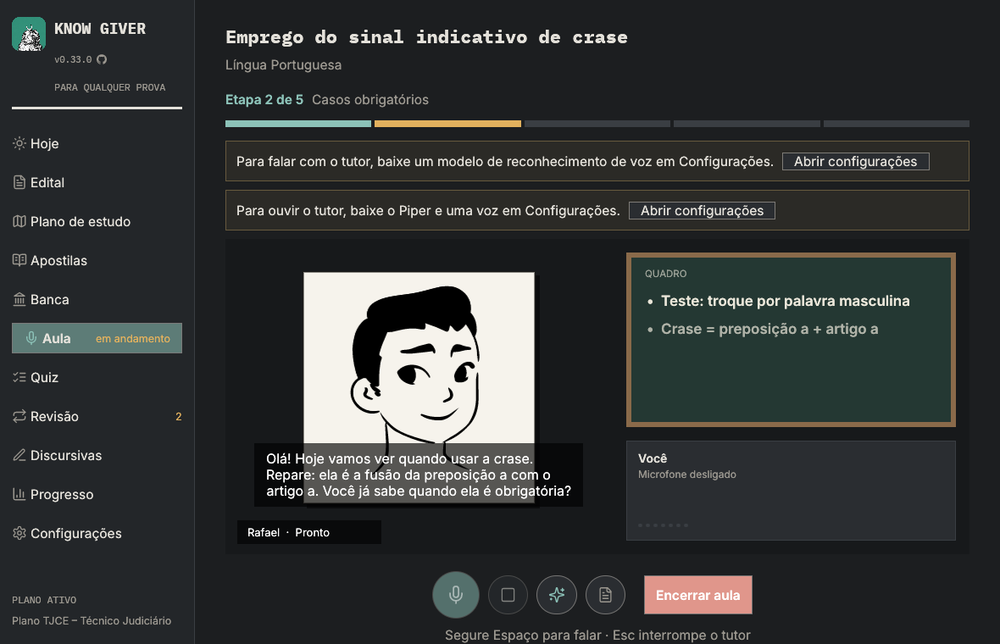
</p>

<p align="center">
  <a href="#do-edital-ao-plano">Edital → plano</a> ·
  <a href="#aulas-por-voz">Aulas por voz</a> ·
  <a href="#um-quadro-que-mostra-não-só-fala">Quadro</a> ·
  <a href="#professores-e-vozes">Professores</a> ·
  <a href="#leia-e-destaque-suas-apostilas">Leitor</a> ·
  <a href="#prática-revisão-e-apostilas">Prática</a> ·
  <a href="#discursivas">Discursivas</a> ·
  <a href="#primeiro-acesso">Primeiro acesso</a> ·
  <a href="#privado-por-padrão">Privacidade</a> ·
  <a href="#começo-rápido">Começo rápido</a> ·
  <a href="#desenvolvimento">Desenvolvimento</a>
</p>

<br>

## Do edital ao plano

O edital é lido no seu computador; só o conteúdo programático vai para a IA.

- **Escolha o cargo.** Alguns editais têm vários cargos. O Know Giver encontra todos e
  pergunta para qual você vai concorrer, então o plano traz as matérias comuns e só as
  específicas do *seu* cargo.
- **Sua rotina.** O número de semanas e de horas por semana define um plano por semana,
  matéria e tópico. Dá para manter vários concursos lado a lado.
- **PDF escaneado.** Páginas sem texto podem ser transcritas por um modelo de visão que
  você configura.

<p align="center">
  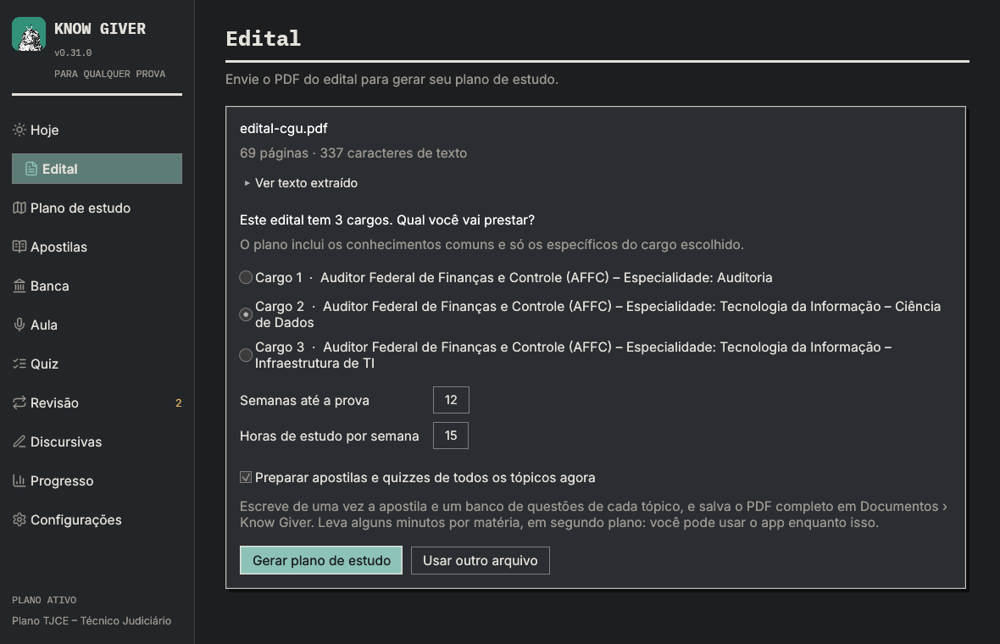
</p>

## Aulas por voz

Você fala e o tutor responde em voz alta, como numa chamada com um professor paciente.

### 🎙️ Escuta
Reconhecimento de fala local: **Parakeet** para as legendas ao vivo enquanto você fala e
**Whisper** como segunda opinião em respostas curtas ou duvidosas. O microfone fica aberto
a aula toda, vozes baixas são amplificadas antes do reconhecimento, e a sua vez termina
depois de uma pausa que você escolhe nas Configurações, para dar tempo de pensar numa
palavra.

### 🗣️ Fala
O tutor começa a falar já na primeira frase da resposta, diz "Hum." enquanto pensa e para
quando você interrompe. As legendas acompanham a voz, frase a frase. Mãos livres, apertar
para falar (Espaço) ou digitando.

### 🧭 Uma aula com começo e fim
Cada aula segue um roteiro feito a partir da apostila do tópico (ou escrito pelo
professor): cada etapa traz os pontos-chave da apostila, o professor confere se você
entendeu antes de seguir, e tudo o que o quiz vai perguntar é visto no caminho. Você sempre
sabe onde está ("Etapa 2 de 5"), e a aula fecha com um resumo e o convite para o quiz.
Escolha aulas **Rápida**, **Normal** ou **Completa** nas Configurações. Aulas feitas ganham
um visto no plano e guardam o roteiro, o quadro e o fechamento para rever depois. Saiu no
meio? **Continuar aula** retoma de onde parou. Palavras e frases em inglês podem ser lidas
por uma voz em inglês.

### 🧠 Ensino
Qualquer modelo compatível com a API da OpenAI (Ollama, LiteLLM, GLM, …) por trás de prompts
de tutor escritos para conversa falada: falas curtas, uma ideia por vez, perguntas de volta
para você. Os prompts seguem o idioma do app: português por padrão, inglês quando o app está
em inglês.

## Um quadro que mostra, não só fala

Além dos pontos-chave, o tutor escreve **fórmulas**, **diagramas**, **tabelas
comparativas**, **linhas do tempo**, **mapas mentais**, **dicas de prova** e **exemplos
resolvidos**, e mostra **imagens** da Wikipédia (só o termo de busca sai do seu
computador).

<p align="center">
  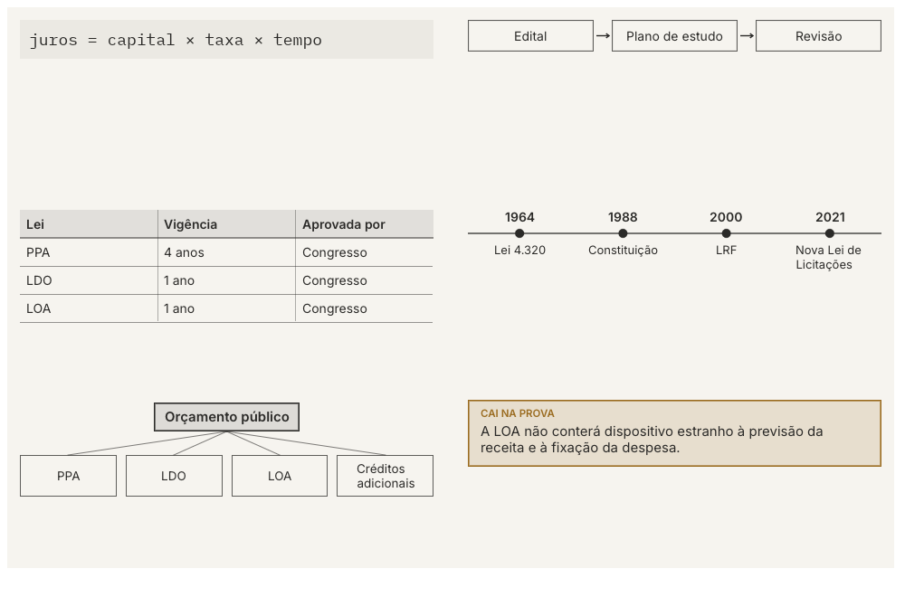
</p>

## Professores e vozes

Escolha quem dá a aula: **Helena**, **Lia**, **Rafael** ou **Otávio**.
Retratos a nanquim que respiram, piscam, acenam com a cabeça enquanto você fala e mexem os
lábios com a voz: humanos o bastante para conversar, desenhados o bastante para não
causar estranheza.

Dez vozes, metade femininas, do **Piper** e do **Kokoro**, todas rodando no seu
computador, mais quatro vozes em inglês para trechos em inglês (sotaques americano e
britânico).

<p align="center">
  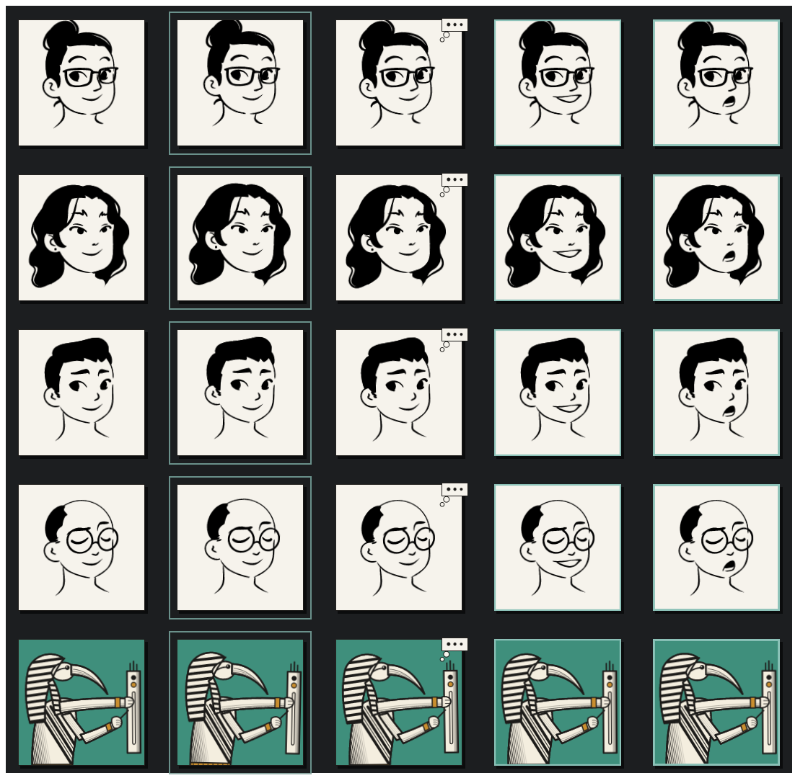
</p>

## Leia e destaque suas apostilas

As apostilas geradas abrem dentro do app, página por página, exatamente como o PDF.
Arraste sobre um trecho para destacar, clique nele para escrever uma nota e encontre todos
os destaques na lista lateral. Navegue pelo sumário, digite uma página, arraste a página
para movê-la ou clique com a rodinha do mouse para rolar sozinho. O Know Giver lembra onde
você parou e quanto já leu de cada apostila, e salva um PDF com os seus destaques quando
você quiser.

<p align="center">
  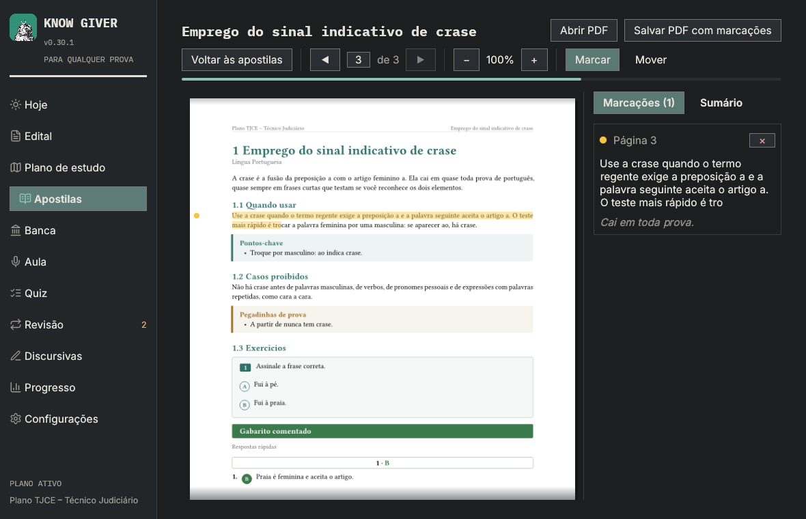
</p>

## Prática, revisão e apostilas

- **Quizzes** no estilo da banca, com explicações; questões reais de provas anteriores
  quando você as envia.
- **Caderno de erros**: toda questão que você erra fica guardada até você acertar; ela abre
  o próximo quiz do tópico e o professor a retoma na aula.
- **Revisão espaçada (SM-2)**: os tópicos voltam pouco antes de você esquecer, como três
  perguntas lidas em voz alta que você pode responder falando.
- **Provas anteriores e material**: provas anteriores (com gabarito, no mesmo arquivo ou
  em outro) e apostilas da banca, filtradas pelo seu conteúdo programático, com o motivo
  de tudo o que fica de fora.
- **Apostilas** por tópico, matéria ou plano inteiro, com imagens, cartões de exercícios e
  gabarito, salvas em PDF.
- **Progresso** por matéria e **tempo de estudo diário**, que conta só o estudo ativo.

## Discursivas

Quando o edital tem redação ou prova discursiva, aparece a área **Discursivas**. Ela nunca
aparece para um edital sem essa prova. Um plano criado antes pode ter o edital lido de novo
(**Revalidar edital**) sem perder tópicos, progresso ou apostilas.

- **Propostas a partir do seu plano**: redação dissertativa, questão discursiva técnica ou
  estudo de caso, sobre tópicos que você escolhe ou sobre o que você estudou e errou. Os
  critérios e a pontuação aparecem antes de você escrever: os do edital (com o trecho
  citado), os seus ou os genéricos do Know Giver, sempre identificados. O padrão de
  resposta fica escondido até a entrega.
- **Escreva à mão e envie fotos**: páginas em JPEG ou PNG, que podem ser giradas,
  reordenadas, trocadas ou removidas antes do envio. Fotos escuras, borradas ou cortadas são
  sinalizadas, e o app pede uma nova em vez de dar nota.
- **Confira a leitura**: foto e transcrição lado a lado. Sua grafia e seus erros são
  mantidos; palavras incertas são marcadas e nunca tiram ponto. Corrigir a leitura fica
  separado da leitura original do modelo; reescrever a resposta vira uma nova versão.
- **Nota formativa**: uma estimativa por critério e no total (somada pelo app), com
  citações conferidas no seu texto, pontos fortes, problemas com sugestões, três
  prioridades e tópicos para revisar. Depois, o padrão de resposta.
- **Evolução**: notas por critério entre tentativas avaliadas com a mesma grade, problemas
  de leitura da foto separados dos de escrita e de conteúdo, e dificuldades recorrentes com
  exemplos das suas próprias tentativas.

As fotos são lidas pelo **modelo de visão** definido em Configurações → IA (um modelo que
aceita imagens; **Testar leitura de imagem** confere isso). Uma foto pode ter uma página ou
um caderno aberto com duas páginas lado a lado. Com um modelo que raciocina antes de
responder, deixe **Respostas rápidas** ligado para que uma página densa não se perca num
raciocínio longo.

<table>
  <tr>
    <td>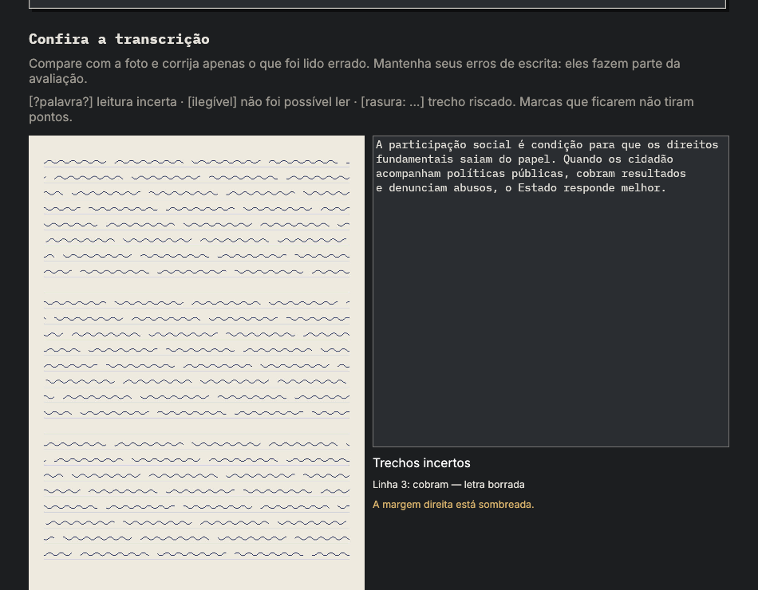</td>
    <td>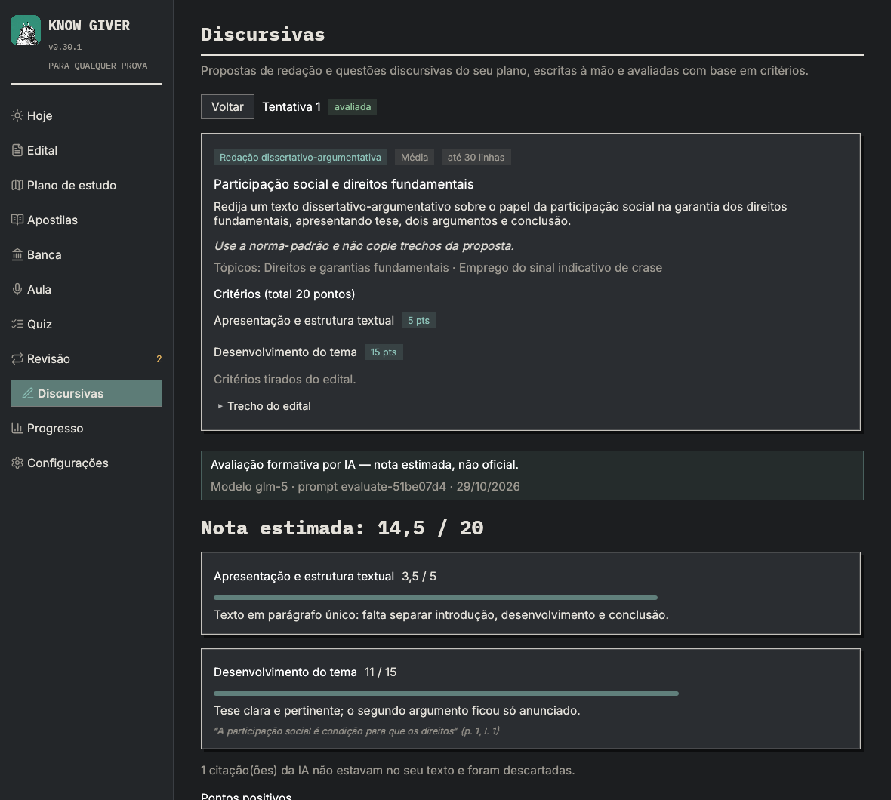</td>
  </tr>
</table>

<table>
  <tr>
    <td>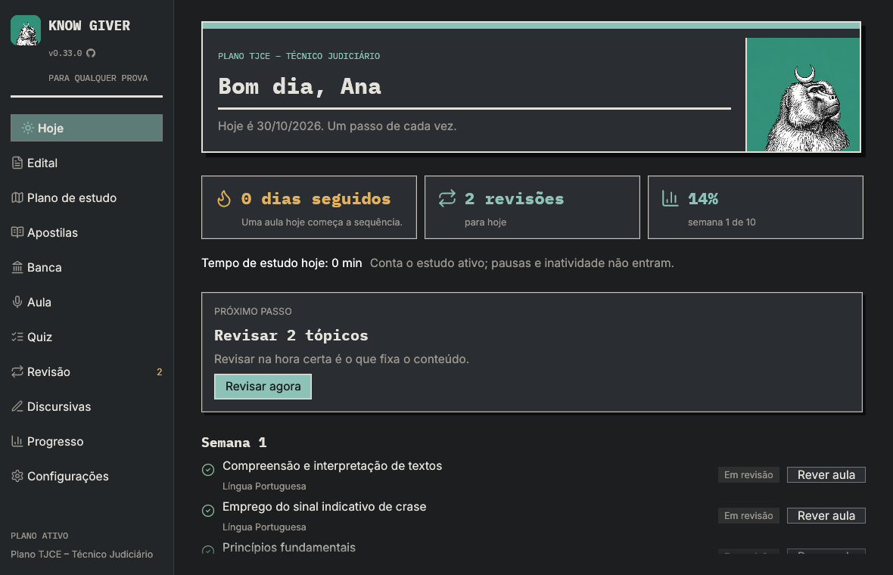</td>
    <td>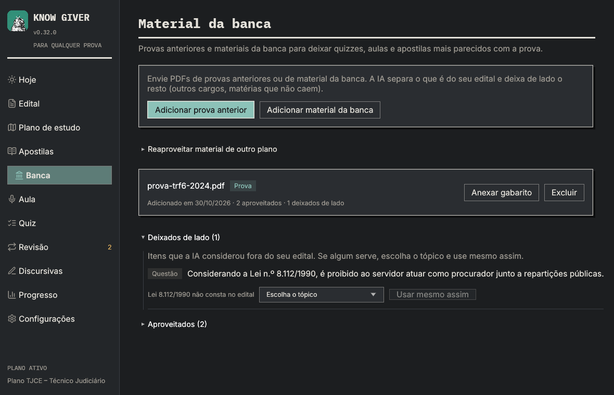</td>
  </tr>
</table>

## Primeiro acesso

Cinco passos curtos antes de tudo: idioma, seu nome, um professor, o serviço de IA com a sua
chave e os termos. Escolha entre 21 fornecedores com seus logos: **Z.ai** é a recomendação
de custo-benefício e **Claude** a de maior acerto, cada um com o link para criar a chave.
Carregue os modelos que a sua chave pode usar ou digite qualquer nome de modelo. Depois vem
um tour rápido pelas telas. Planos já criados são mantidos.

<table>
  <tr>
    <td>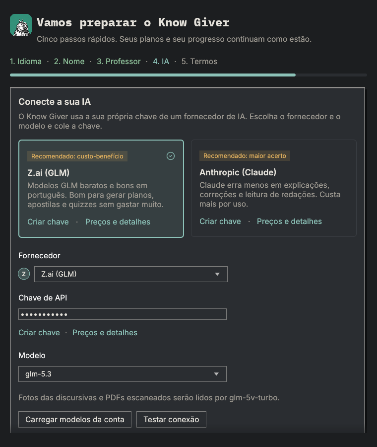</td>
    <td>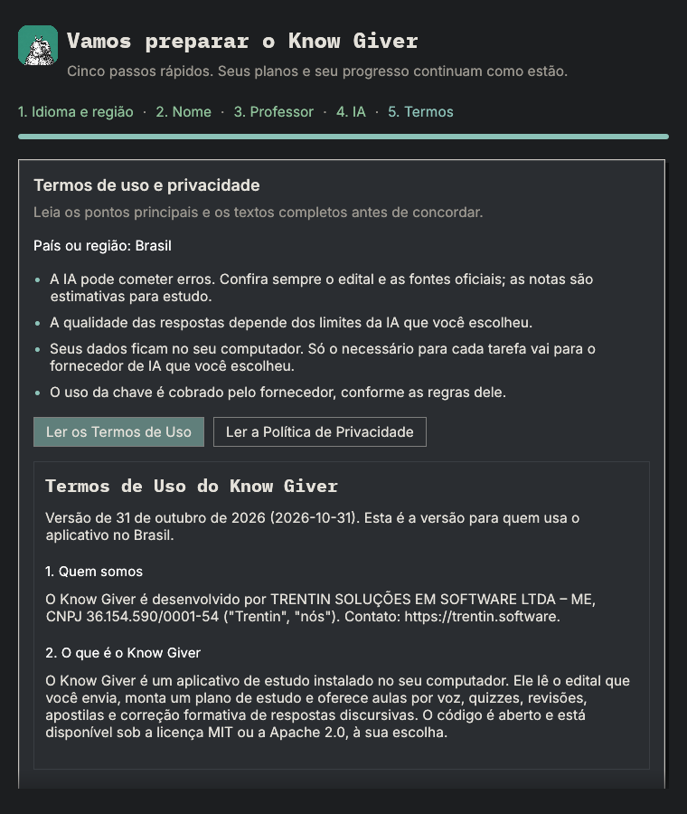</td>
  </tr>
</table>

<p align="center">
  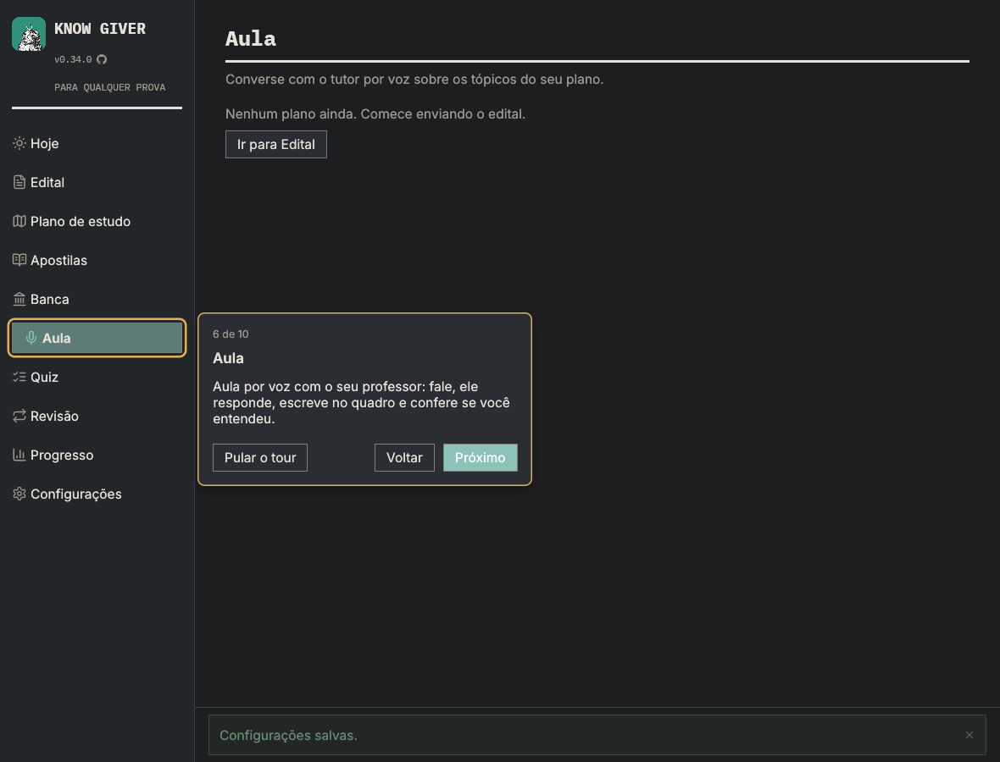
</p>

## Privado por padrão

- O reconhecimento de fala e as vozes rodam no seu computador. As gravações nunca saem
  dele.
- Seus dados (banco SQLite, modelos, log) ficam em `%LOCALAPPDATA%\KnowGiver`, ou em
  `KG_DATA_DIR` quando definido.
- Só texto vai para o serviço de IA que você configura, e só o que a tarefa precisa. A
  exceção é opcional: com um modelo de visão definido, fotos de páginas manuscritas (e
  páginas de PDFs escaneados) são enviadas a ele para leitura. O app diz para onde antes de
  enviar; as fotos ficam na sua pasta de dados e são apagadas junto com a tentativa. Os logs
  nunca guardam imagens, respostas ou chaves.
- Ao abrir, o app pergunta ao GitHub qual é a versão mais recente; só esse pedido sai, e
  Configurações → Sobre e atualizações desliga a busca.
- Sem conta, telemetria ou anúncios. Leia os [Termos de Uso](docs/legal/terms-of-use.pt-BR.md)
  e a [Política de Privacidade](docs/legal/privacy-policy.pt-BR.md) (LGPD), também
  mostrados no app.

## Instalação

Cada versão sai como um [release no GitHub](https://github.com/czarist/know-giver/releases/latest), com pacotes para Windows (x64), macOS (Apple silicon) e Linux (x86_64). Um comando baixa a mais recente, confere com os checksums do release e instala para o seu usuário, sem precisar de administrador. Seus planos e o seu progresso continuam.

**Windows** (PowerShell):

```powershell
irm https://raw.githubusercontent.com/czarist/know-giver/main/scripts/install.ps1 | iex
```

**macOS** (Terminal):

```bash
curl -fsSL https://raw.githubusercontent.com/czarist/know-giver/main/scripts/install.sh | bash
```

**Linux** (terminal):

```bash
curl -fsSL https://raw.githubusercontent.com/czarist/know-giver/main/scripts/install.sh | bash
```

No Windows, vai para `%LOCALAPPDATA%\Programs\KnowGiver`, com atalho no menu Iniciar; no macOS, para `~/Applications/Know Giver.app`; no Linux, para `~/.local/opt/KnowGiver`, com o comando `know-giver` e um atalho no menu de aplicativos.

**Atualizações:** quando sai uma versão nova, uma barra discreta no topo do app oferece a atualização com um botão verde de download. O app baixa, confere, instala e abre de novo. Configurações → Sobre e atualizações desliga a busca.

## Começo rápido

```bash
cargo run --release
```

O primeiro acesso pede cinco coisas antes de abrir o resto: idioma, seu nome, um
professor, o serviço de IA com a sua chave e o aceite dos termos. Escolha o fornecedor e o
modelo na lista (**Z.ai** é a recomendação de custo-benefício, **Claude** a de maior
acerto, cada um com o link para criar a chave) ou carregue os modelos que a sua chave pode
usar. Depois vem um tour rápido pelas telas. Planos já criados são mantidos.

Para desenvolvimento, o `.env` (copie o `.env.example`) ainda pode definir o endereço e os
modelos; ele tem prioridade sobre variáveis globais com o mesmo nome. Baixe os modelos de
fala nas Configurações. Rust 1.95 ou mais novo.

**Pacote para Windows:**

```powershell
powershell -ExecutionPolicy Bypass -File scripts\package.ps1
```

Gera `dist\KnowGiver-<versão>-windows-x64.zip`, e também um instalador quando o
[Inno Setup 6](https://jrsoftware.org/isinfo.php) está instalado.

## Desenvolvimento

```
crates/
  app/      # binário know-giver (ponto de entrada, ícone)
  ui/       # interface egui (telas, tema, traduções)
  engine/   # estado do app, comandos, trabalho em segundo plano, ciclo de voz
  study/    # planos, revisões (SM-2), quizzes, armazenamento SQLite
  ai/       # cliente compatível com OpenAI + prompts (crates/ai/prompts/{pt,en})
  audio/    # captura do microfone, STT Parakeet/Whisper, TTS Piper/Kokoro, reprodução, downloads
  pdf/      # extração do texto do edital, cargos
  handout/  # apostilas renderizadas em PDF com Typst
locales/    # traduções da interface (pt-BR, en)
tools/      # geradores de arte (ícone, retratos dos professores)
```

As dependências seguem um sentido só: `app → ui → engine → {study, ai, audio, pdf, handout}`.
Veja [docs/architecture.md](docs/architecture.md) (em inglês, como o resto da documentação
técnica).

```bash
cargo fmt
cargo clippy --workspace --all-targets -- -D warnings
cargo test --workspace
```

Compilar o workspace inteiro ocupa todos os núcleos da CPU por minutos. Numa máquina que
esquenta demais ou tem fonte fraca, limite os jobs: `cargo test -j 2 --workspace --
--test-threads=2` (ou `jobs = 2` em `[build]` no `.cargo/config.toml`).

Verificações manuais com os serviços reais (precisam do `.env` e de rede):

```bash
cargo run -p kg-ai --example live_check                          # todas as tarefas de IA (KG_PROMPT_LANG=en para prompts em inglês)
cargo run -p kg-engine --example e2e -- edital.pdf                # importar → plano → quiz → revisão → apostila
cargo run --release -p kg-audio --example parakeet_check -- <pasta-dos-modelos> fala.wav
KG_SNAPSHOT_DIR=shots cargo test -p kg-ui snapshots -- --ignored  # gera um PNG de cada tela
```

Mais: [builds nativos/CUDA](docs/builds.md), [avaliação do Kokoro](docs/kokoro-evaluation.md),
[notas de validação](docs/validation-v0.15.md),
[conferência manual das discursivas](docs/validation-discursive.md).

## Créditos

- Ícone do app e arte da capa: Thoth como babuíno sob a lua crescente, num ladrilho de
  jade, por [Cezar Trentin](https://cezartrentin.dev) (`crates/ui/assets/art/thoth-tile.png`);
  `python tools/icon.py` gera os ícones do app e do Windows a partir dela.
- Fontes: [Inter](https://rsms.me/inter/) e [IBM Plex Mono](https://github.com/IBM/plex),
  SIL Open Font License (`crates/ui/assets/fonts`).
- Retratos dos professores (`crates/ui/assets/teachers`): "Lorelei", de Lisa Wischofsky,
  CC0 1.0, via [DiceBear](https://www.dicebear.com/styles/lorelei/); refeitos com
  `python tools/teachers.py`.
- Voz Dii (baixada sob demanda): [OpenVoiceOS/pipertts_pt-BR_dii](https://huggingface.co/OpenVoiceOS/pipertts_pt-BR_dii),
  CC BY-NC-ND 4.0, uso pessoal não comercial.
- As imagens do quadro vêm da [Wikipédia](https://pt.wikipedia.org); a legenda indica o
  artigo, onde estão o autor e a licença de cada imagem.
- Ícones: [Lucide](https://lucide.dev), licença ISC (`crates/ui/assets/icons`).
- Logos dos fornecedores de IA: [Simple Icons](https://simpleicons.org), CC0
  (`crates/ui/assets/providers`); os logos são marcas dos seus donos, usados só para
  identificar cada serviço.

## Licença

Licenciado sob [MIT](LICENSE-MIT) ou [Apache License 2.0](LICENSE-APACHE), à sua escolha
(`MIT OR Apache-2.0`). Salvo indicação em contrário, qualquer contribuição enviada para
inclusão no projeto fica sob as duas licenças, sem termos adicionais.

Fontes, retratos e vozes de terceiros mantêm suas próprias licenças, listadas em
[Créditos](#créditos). Para relatar uma vulnerabilidade, veja [SECURITY.md](SECURITY.md).
