<p align="center">
  
</p>

<h1 align="center">Know Giver</h1>

<h3 align="center">你的考试。你的计划。一位会和你对话的老师。</h3>

<p align="center">
  <a href="README.md">English</a> · <a href="README.pt-BR.md">Português (Brasil)</a> · <a href="README.ja.md">日本語</a> · <a href="README.zh-Hans.md">简体中文</a> · <a href="README.zh-Hant.md">繁體中文</a>
</p>

<p align="center">
  <b>为考试制定学习计划的桌面应用，完全用 Rust 编写。</b><br>
  放入考试公告或大纲的 PDF，得到按周安排的计划，并和一位会倾听、讲解、出题的老师一起学习。
</p>

<p align="center">
  <a href="https://www.rust-lang.org"></a>
  <a href="https://github.com/emilk/egui"></a>
  <a href="https://www.sqlite.org"></a>
  <a href="https://typst.app"></a>
  
  <a href="https://github.com/rhasspy/piper"></a>
  
  
  
  
  <a href="#license"></a>
  <a href="https://github.com/czarist/know-giver/tags"></a>
  
  
  <a href="https://github.com/czarist/know-giver/actions/workflows/packages.yml"></a>
</p>

<br>

<p align="center">
  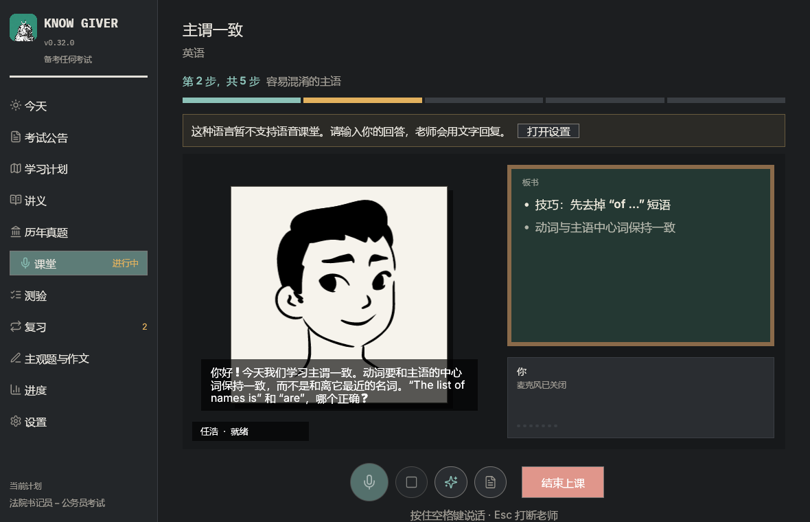
</p>

<p align="center">
  <a href="#从考试公告到学习计划">公告 → 计划</a> ·
  <a href="#课堂">课堂</a> ·
  <a href="#板书">板书</a> ·
  <a href="#阅读并标记讲义">讲义</a> ·
  <a href="#练习复习讲义">练习</a> ·
  <a href="#主观题与作文">主观题与作文</a> ·
  <a href="#首次设置">首次设置</a> ·
  <a href="#隐私">隐私</a> ·
  <a href="#开始使用">开始使用</a>
</p>

<br>

## 从考试公告到学习计划

考试公告在你的电脑上读取，只有考试大纲会发送给 AI。

- **选择职位。** 有些考试招考多个职位。Know Giver 会找出这些职位，问你报考哪一个，计划只包含公共科目和*你的*职位的专业科目。
- **按你的时间安排。** 根据距离考试的周数和每周学习时长，按周、科目和知识点制定计划。可以同时管理多个考试。
- **扫描版 PDF。** 没有文字的页面可以由你设置的图片模型转写。

<p align="center">
  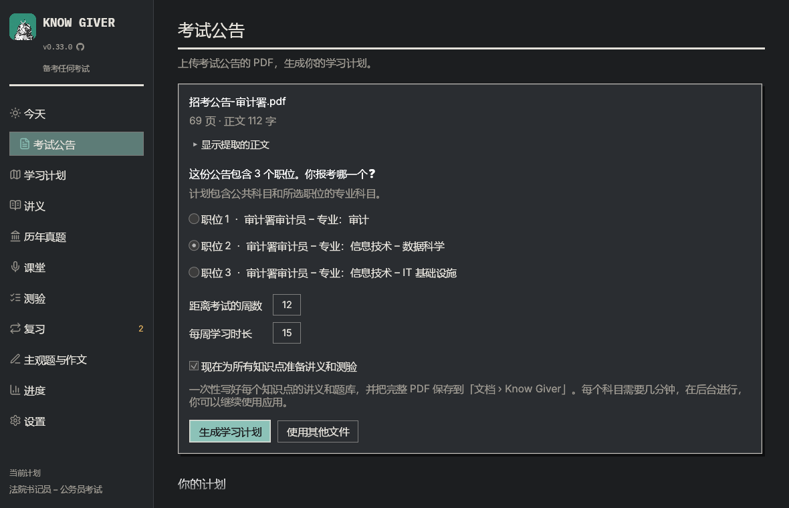
</p>

## 课堂

老师按照课程安排一步步讲解知识点：每一步讲到讲义的要点，确认你理解后再继续，并覆盖测验会考的所有内容。最后有总结和测验提示。可选择「快速」「标准」「完整」三种长度。

**中文课堂目前通过文字进行。** 语音（本地语音识别和朗读）目前支持葡萄牙语和英语，中文语音将在之后支持。也可以在设置中使用云端语音服务。

AI 可以使用任何兼容 OpenAI 的模型（Z.ai、DeepSeek、Qwen、Kimi、Anthropic、OpenAI、Gemini、Ollama 等），给老师的指令（提示词）会跟随应用语言使用中文。

## 板书

除了要点，老师还会写**公式**、**流程图**、**对比表**、**时间线**、**思维导图**、**考试提示**和**例子**，并展示 Wikipedia 的**图片**（只有搜索词会离开你的电脑）。

<p align="center">
  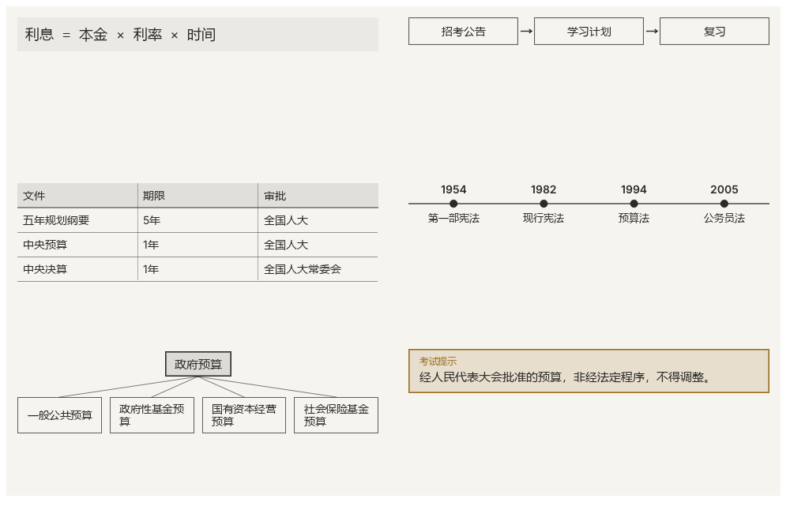
</p>

四位老师：**何静**、**李悦**、**任浩**、**欧阳文**。会呼吸、眨眼、点头的水墨肖像。

<p align="center">
  
</p>

## 阅读并标记讲义

生成的讲义在应用内打开，页面与 PDF 完全相同。拖动文字即可标记，点击标记可写笔记，侧边列表可跳到每处标记。应用会记住读到哪里，也可以保存带标记的 PDF。

<p align="center">
  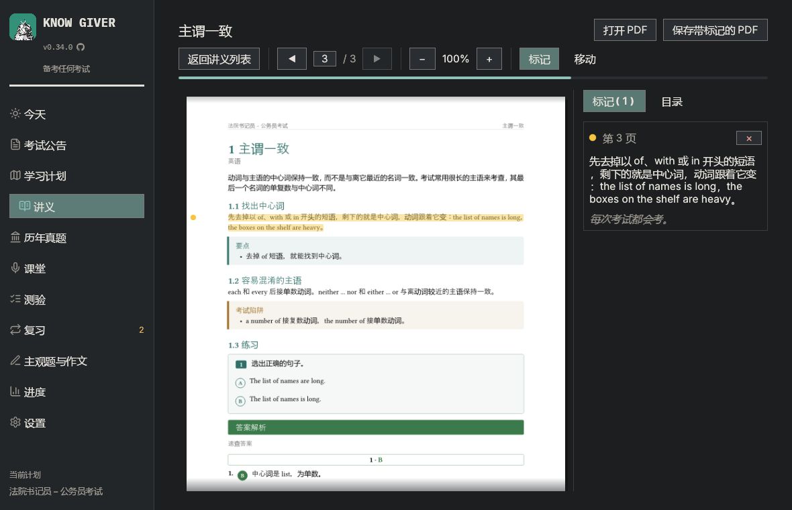
</p>

## 练习、复习、讲义

- **测验**：考试风格的题目和解析；上传历年真题后会有真题。
- **错题本**：答错的题会一直保留到答对为止，并出现在下一次测验的开头。
- **间隔复习（SM-2）**：知识点会在你快要忘记之前回来。
- **真题与资料**：历年真题（附答案）和资料会按公告范围筛选，并说明搁置的原因。
- **讲义**：按知识点、科目或整个计划生成，含图片、练习和答案的 PDF。
- **进度**：各科目的进展和实际学习时间。

## 主观题与作文

考试公告中有作文或主观题考试时，会出现**主观题与作文**区域。

- **根据计划出题**：议论文、专业主观题或案例分析。动笔前会显示评分标准和分值（来自公告、你自己设定，或 Know Giver 的通用标准）。
- **手写作答并上传照片**：JPEG 或 PNG。太暗、模糊或拍不全的照片会要求重拍。
- **核对读取结果**：照片和转写并排显示。你的书写错误会保留，不确定的字词不会扣分。
- **形成性评分**：按标准估计的分数、经过核对的原文引用、优点、问题和建议、三个优先事项。

照片由设置 → AI 中的**图片模型**读取。按字数要求的中文作文，字数要求会写在题目说明中。

<table>
  <tr>
    <td>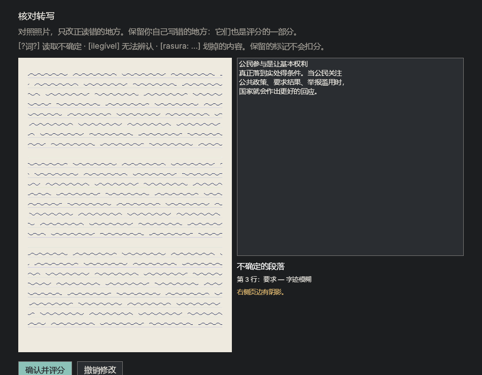</td>
    <td>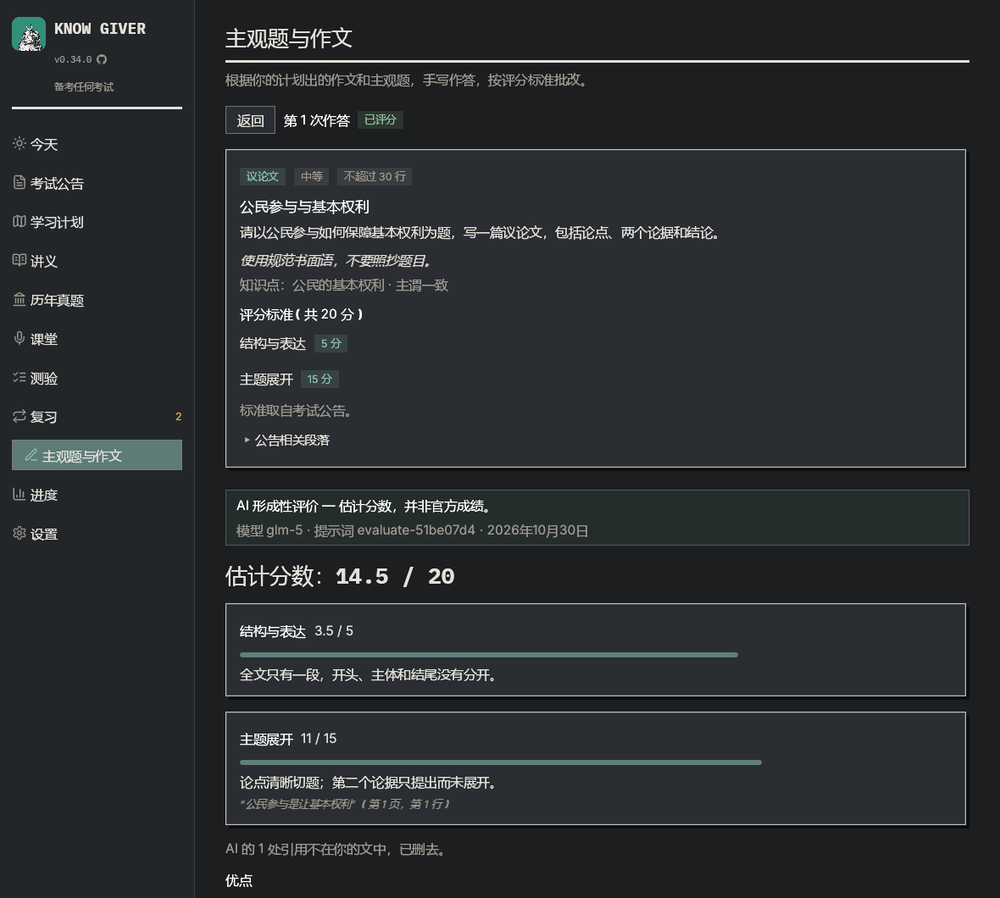</td>
  </tr>
</table>

<table>
  <tr>
    <td>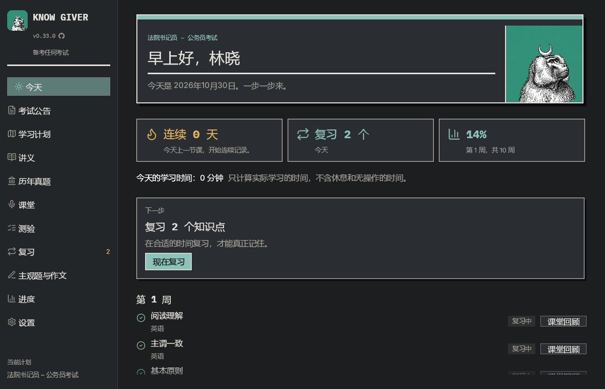</td>
    <td>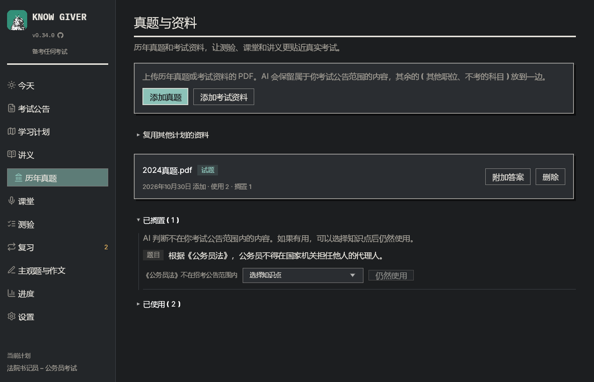</td>
  </tr>
</table>

## 首次设置

首先有五个简短步骤：语言、名字、老师、AI 和密钥、国家或地区及同意条款。可以从 21 个 AI 服务商中选择（**Z.ai** 性价比高，**Claude** 准确度高），并附有创建密钥的链接。之后有一段简短的界面导览。

<table>
  <tr>
    <td>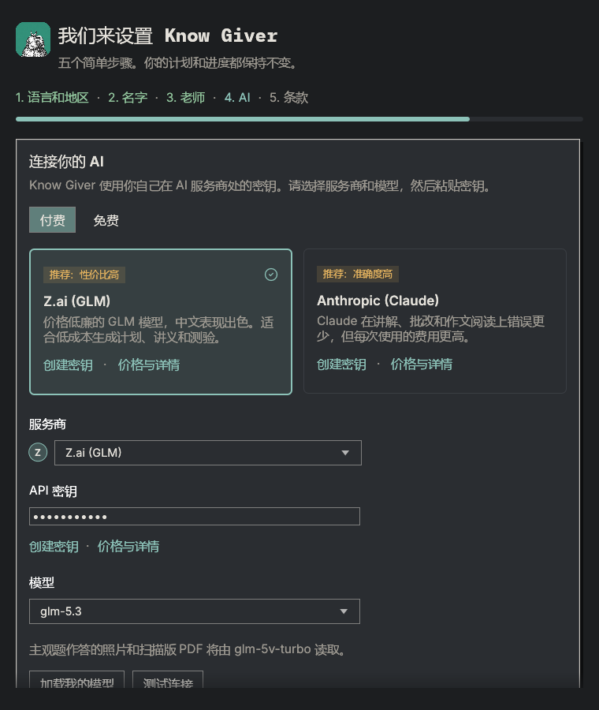</td>
    <td>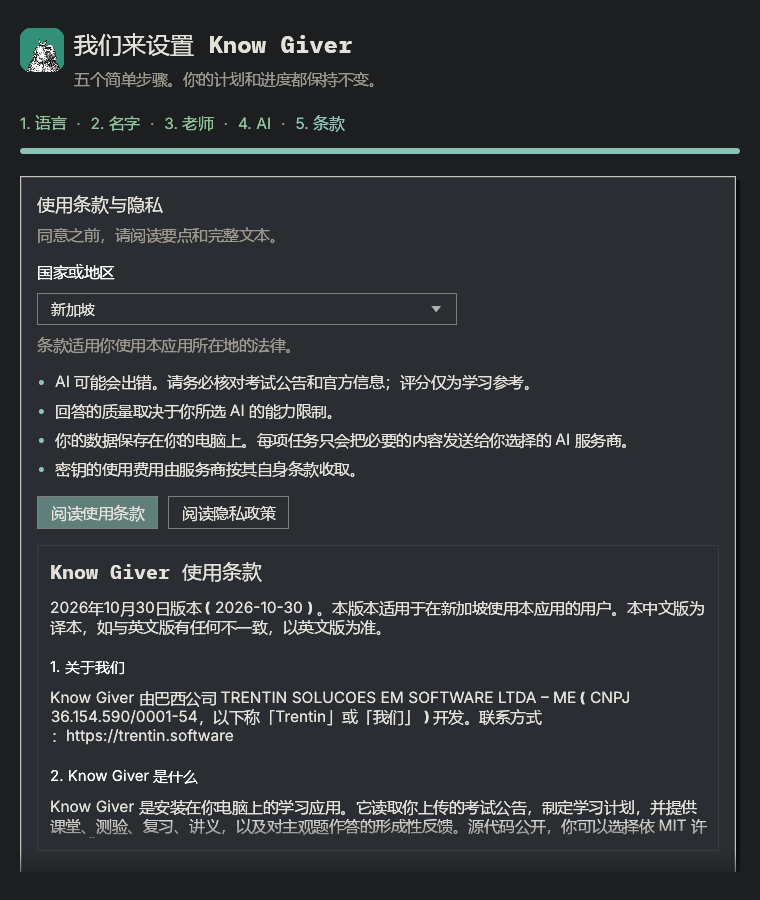</td>
  </tr>
</table>

<p align="center">
  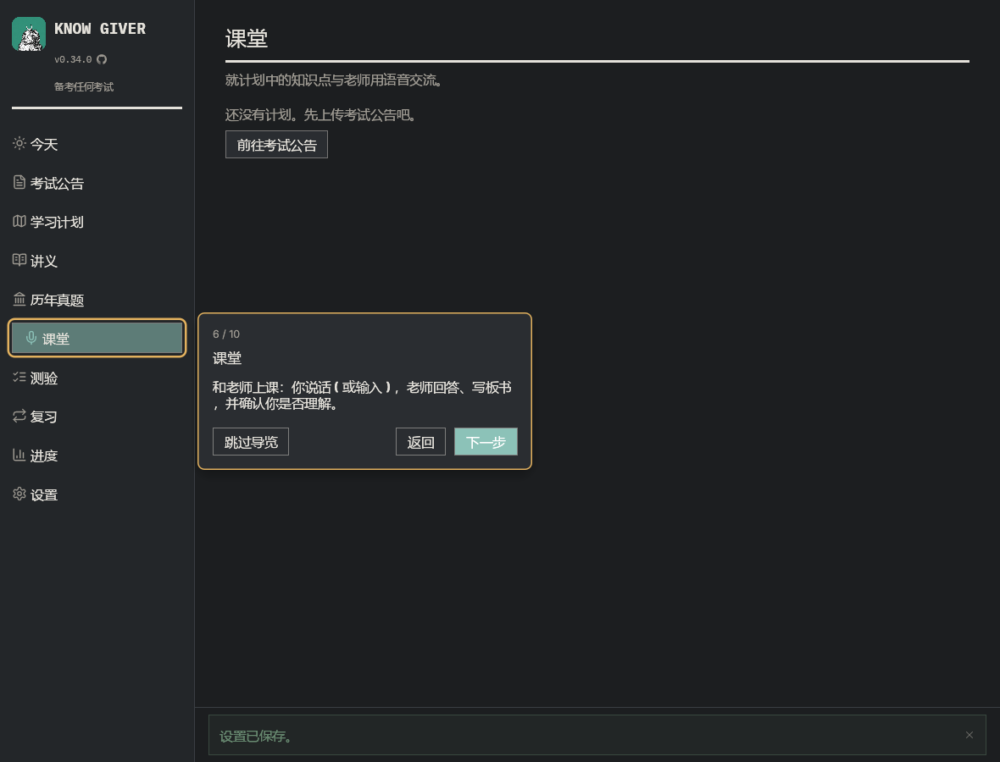
</p>

## 隐私

- 语音识别和朗读在你的电脑上运行，录音不会离开电脑。
- 数据（SQLite 数据库、模型、日志）保存在 `%LOCALAPPDATA%\KnowGiver`。
- 只有任务所需的文字会发送给你配置的 AI 服务。只有在设置了图片模型时，答卷照片才会发送给该模型。
- 打开时，应用会向 GitHub 查询最新版本；只发送这个请求，可在 设置 → 关于与更新 中关闭。
- 没有账户、遥测或广告。

Know Giver 在新加坡、巴西、美国、欧盟、英国、日本、台湾和香港向公众提供；新加坡的条款见[使用条款](docs/legal/terms-of-use.zh-Hans.md)和[隐私政策](docs/legal/privacy-policy.zh-Hans.md)（以英文版为准），也会在应用中显示。在其他国家和地区（包括中国大陆），仅限经书面授权的合作伙伴按[合作伙伴访问条款](docs/legal/partner-access.zh-Hans.md)使用；选择中国大陆时，只列出在中国大陆提供服务的 AI 服务商（如智谱、阿里云百炼、DeepSeek、Kimi）。

## 安装

每个版本都会发布为 [GitHub Release](https://github.com/czarist/know-giver/releases/latest)，提供 Windows（x64）、macOS（Apple 芯片）和 Linux（x86_64）的安装包。下面的命令会下载最新版本，用 Release 的校验和核对后，为当前用户安装，不需要管理员权限。你的计划和进度都会保留。

**Windows**（PowerShell）：

```powershell
irm https://raw.githubusercontent.com/czarist/know-giver/main/scripts/install.ps1 | iex
```

**macOS**（终端）：

```bash
curl -fsSL https://raw.githubusercontent.com/czarist/know-giver/main/scripts/install.sh | bash
```

**Linux**（终端）：

```bash
curl -fsSL https://raw.githubusercontent.com/czarist/know-giver/main/scripts/install.sh | bash
```

Windows 安装到 `%LOCALAPPDATA%\Programs\KnowGiver`，并加入开始菜单；macOS 安装到 `~/Applications/Know Giver.app`；Linux 安装到 `~/.local/opt/KnowGiver`，并提供 `know-giver` 命令和应用菜单项。

**更新：** 有新版本时，应用顶部会出现一条细栏，用绿色的下载按钮提示更新。应用会下载、核对、安装，然后重新打开。可在 设置 → 关于与更新 中关闭检查。

## 开始使用

```bash
cargo run --release
```

首次启动时会打开首次设置。需要 Rust 1.95 或更新版本。Windows 安装包：

```powershell
powershell -ExecutionPolicy Bypass -File scripts\package.ps1
```

开发相关内容请参阅 [English README](README.md#development)（技术文档为英文）。

## 许可证

可选择依 [MIT](LICENSE-MIT) 或 [Apache License 2.0](LICENSE-APACHE) 使用（`MIT OR Apache-2.0`）。第三方字体、肖像、语音和标志各有其许可（见 [English README 的 Credits](README.md#credits)）。报告安全漏洞请参阅 [SECURITY.md](SECURITY.md)。
