<p align="center">
  
</p>

<h1 align="center">Know Giver</h1>

<h3 align="center">你的考試。你的計劃。一位會和你對話的老師。</h3>

<p align="center">
  <a href="README.md">English</a> · <a href="README.pt-BR.md">Português (Brasil)</a> · <a href="README.ja.md">日本語</a> · <a href="README.zh-Hans.md">简体中文</a> · <a href="README.zh-Hant.md">繁體中文</a>
</p>

<p align="center">
  <b>為考試製定學習計劃的桌面程式，完全用 Rust 編寫。</b><br>
  放入考試公告或大綱的 PDF，得到按周安排的計劃，並和一位會傾聽、講解、出題的老師一起學習。
</p>

<p align="center">
  <a href="https://www.rust-lang.org"></a>
  <a href="https://github.com/emilk/egui"></a>
  <a href="https://www.sqlite.org"></a>
  <a href="https://typst.app"></a>
  
  <a href="https://github.com/rhasspy/piper"></a>
  
  
  
  
  <a href="#license"></a>
  <a href="https://github.com/czarist/know-giver/tags"></a>
  
  
  <a href="https://github.com/czarist/know-giver/actions/workflows/packages.yml"></a>
</p>

<br>

<p align="center">
  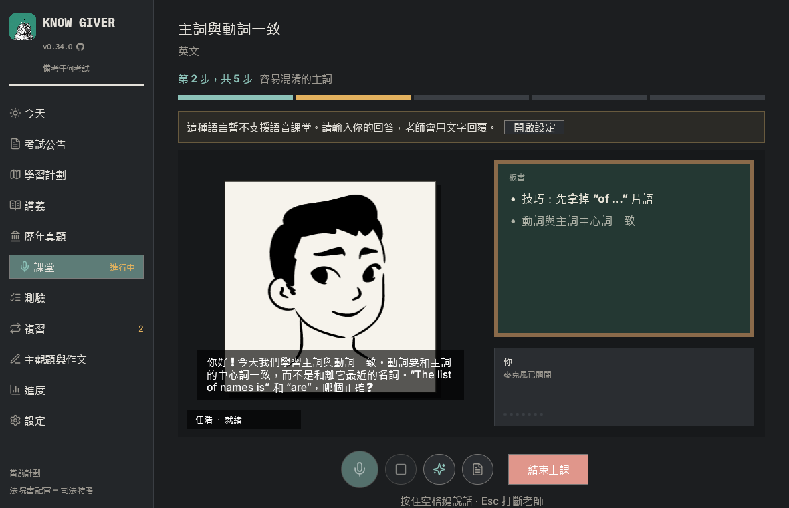
</p>

<p align="center">
  <a href="#從考試公告到學習計劃">公告 → 計劃</a> ·
  <a href="#課堂">課堂</a> ·
  <a href="#板書">板書</a> ·
  <a href="#閱讀並標記講義">講義</a> ·
  <a href="#練習複習講義">練習</a> ·
  <a href="#主觀題與作文">主觀題與作文</a> ·
  <a href="#首次設定">首次設定</a> ·
  <a href="#隱私">隱私</a> ·
  <a href="#開始使用">開始使用</a>
</p>

<br>

## 從考試公告到學習計劃

考試公告在你的電腦上讀取，只有考試大綱會傳送給 AI。

- **選擇職位。** 有些考試招考多個職位。Know Giver 會找出這些職位，問你報考哪一個，計劃只包含公共科目和*你的*職位的專業科目。
- **按你的時間安排。** 根據距離考試的週數和每週學習時長，按周、科目和知識點制定計劃。可以同時管理多個考試。
- **掃描版 PDF。** 沒有文字的頁面可以由你設定的圖片模型轉寫。

<p align="center">
  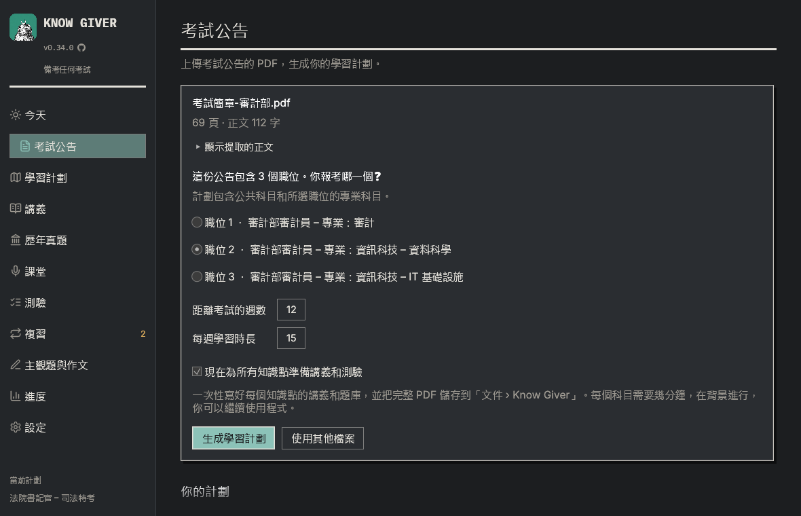
</p>

## 課堂

老師按照課程安排一步步講解知識點：每一步講到講義的要點，確認你理解後再繼續，並覆蓋測驗會考的所有內容。最後有總結和測驗提示。可選擇「快速」「標準」「完整」三種長度。

**中文課堂目前透過文字進行。** 語音（本地語音識別和朗讀）目前支援葡萄牙語和英語，中文語音將在之後支援。也可以在設定中使用雲端語音服務。

AI 可以使用任何相容 OpenAI 的模型（Z.ai、DeepSeek、Qwen、Kimi、Anthropic、OpenAI、Gemini、Ollama 等），給老師的指令（提示詞）會跟隨程式語言使用中文。

## 板書

除了要點，老師還會寫**公式**、**流程圖**、**對比表**、**時間線**、**思維導圖**、**考試提示**和**例子**，並展示 Wikipedia 的**圖片**（只有搜尋詞會離開你的電腦）。

<p align="center">
  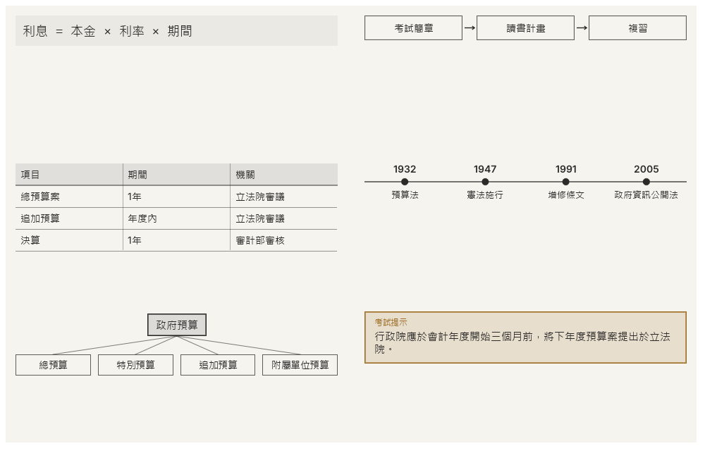
</p>

四位老師：**何靜**、**李悅**、**任浩**、**歐陽文**。會呼吸、眨眼、點頭的水墨肖像。

<p align="center">
  
</p>

## 閱讀並標記講義

生成的講義在程式內開啟，頁面與 PDF 完全相同。拖動文字即可標記，點選標記可寫筆記，側邊列表可跳到每處標記。程式會記住讀到哪裡，也可以儲存帶標記的 PDF。

<p align="center">
  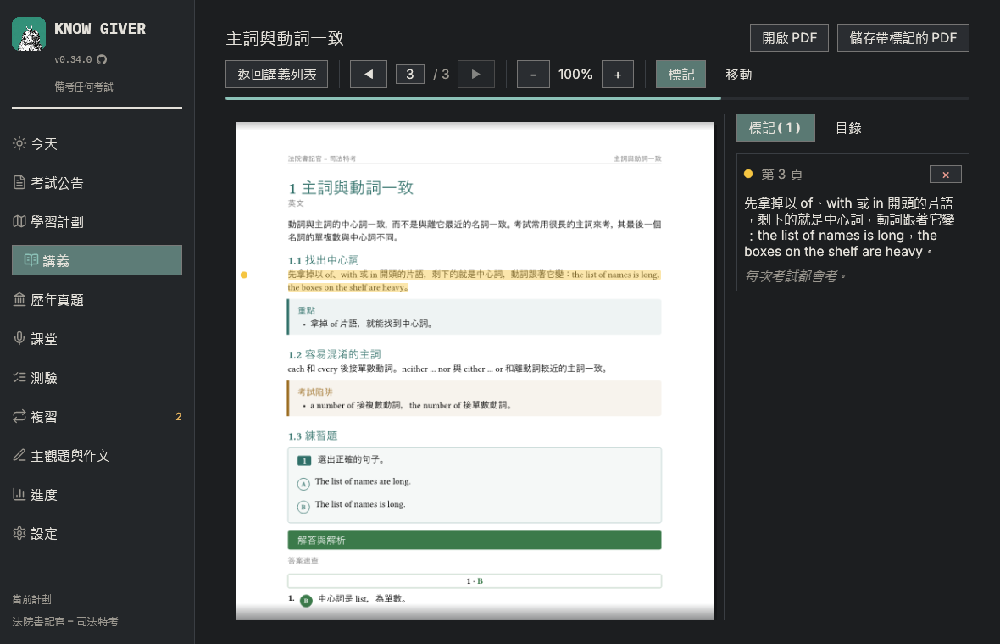
</p>

## 練習、複習、講義

- **測驗**：考試風格的題目和解析；上傳歷年真題後會有真題。
- **錯題本**：答錯的題會一直保留到答對為止，並出現在下一次測驗的開頭。
- **間隔複習（SM-2）**：知識點會在你快要忘記之前回來。
- **真題與資料**：歷年真題（附答案）和資料會按公告範圍篩選，並說明擱置的原因。
- **講義**：按知識點、科目或整個計劃生成，含圖片、練習和答案的 PDF。
- **進度**：各科目的進展和實際學習時間。

## 主觀題與作文

考試公告中有作文或主觀題考試時，會出現**主觀題與作文**區域。

- **根據計劃出題**：議論文、專業主觀題或案例分析。動筆前會顯示評分標準和分值（來自公告、你自己設定，或 Know Giver 的通用標準）。
- **手寫作答並上傳照片**：JPEG 或 PNG。太暗、模糊或拍不全的照片會要求重拍。
- **核對讀取結果**：照片和轉寫並排顯示。你的書寫錯誤會保留，不確定的字詞不會扣分。
- **形成性評分**：按標準估計的分數、經過核對的原文引用、優點、問題和建議、三個優先事項。

照片由設定 → AI 中的**圖片模型**讀取。按字數要求的中文作文，字數要求會寫在題目說明中。

<table>
  <tr>
    <td>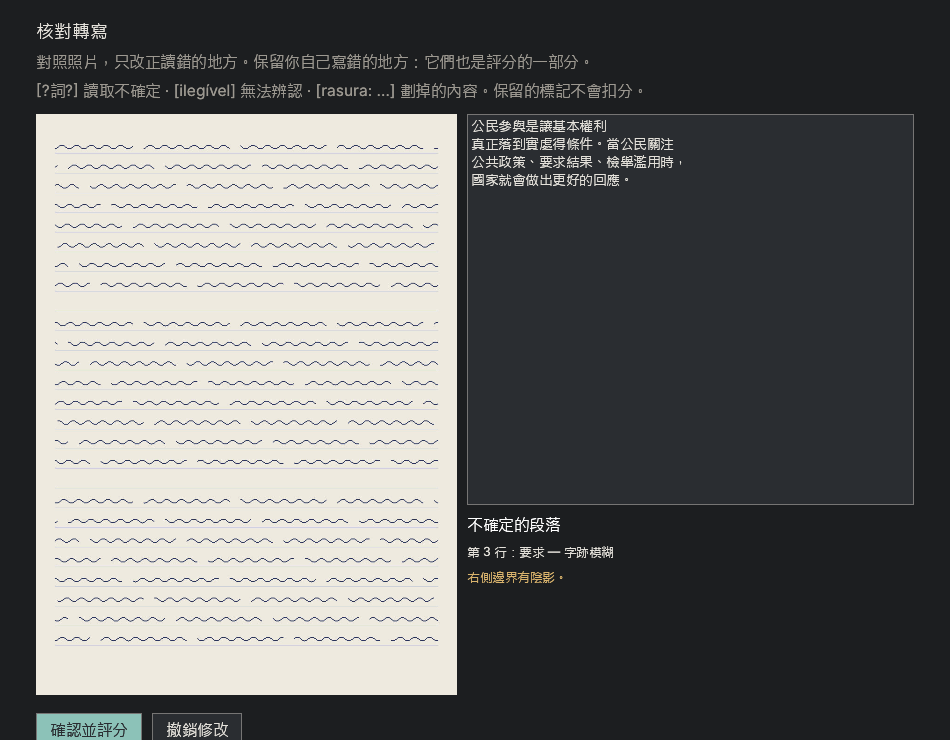</td>
    <td>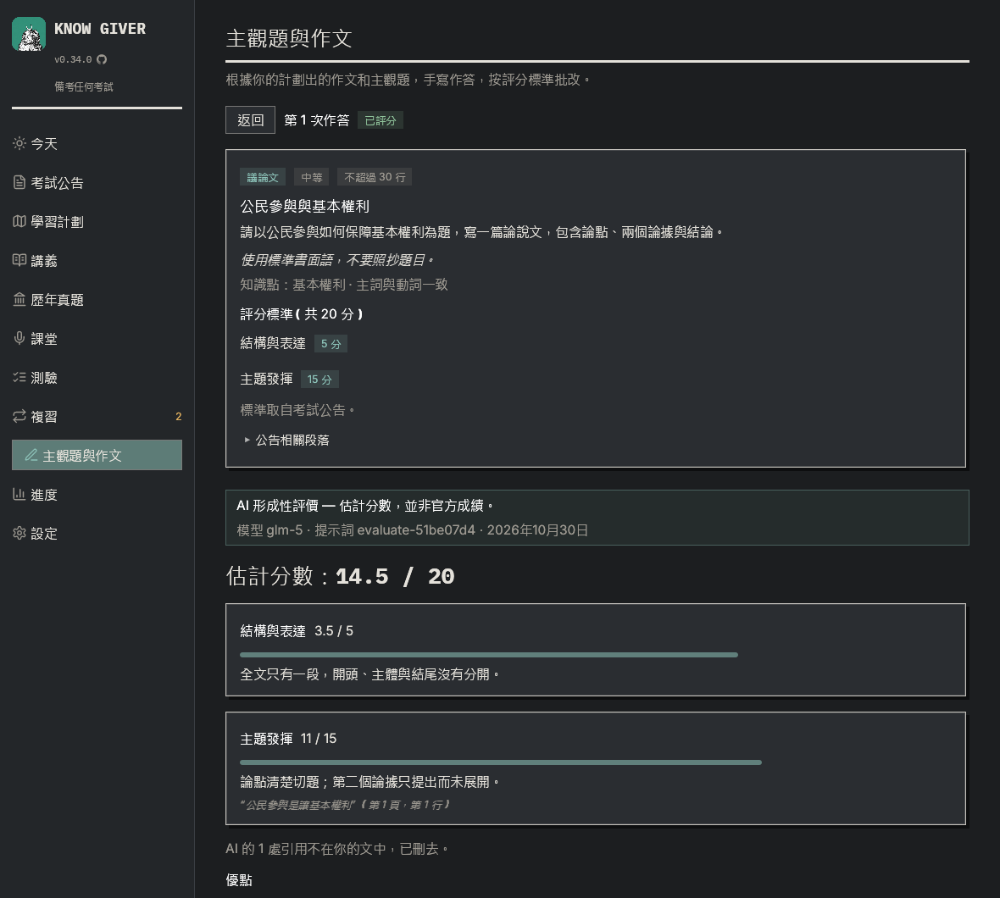</td>
  </tr>
</table>

<table>
  <tr>
    <td>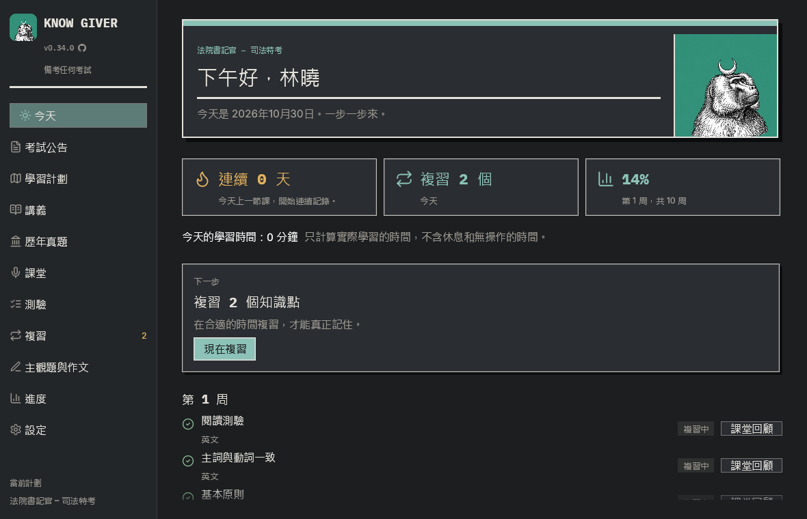</td>
    <td>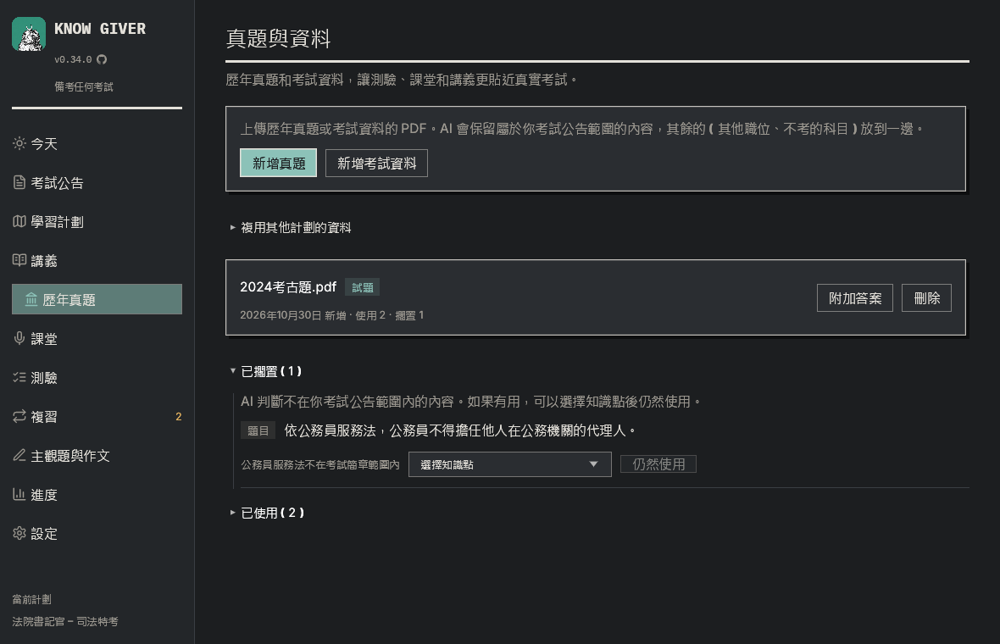</td>
  </tr>
</table>

## 首次設定

首先有五個簡短步驟：語言、名字、老師、AI 和金鑰、國家或地區及同意條款。可以從 21 個 AI 服務商中選擇（**Z.ai** 價效比高，**Claude** 準確度高），並附有建立金鑰的連結。之後有一段簡短的介面導覽。

**免費或付費。** AI 步驟有兩個分頁。「付費」顯示推薦的服務（CP 值高的 Z.ai、準確度高的 Claude）；「免費」列出有免費方案的服務（Gemini、Mistral、OpenRouter、Groq、NVIDIA、GitHub Models，以及在你電腦上執行的 Ollama 或 LM Studio），每項顯示方案包含的模型、如何使用你傳送的內容（有些免費方案會用於訓練）以及限額與規則的連結。

**你所在地區的備考方式。** 課堂、測驗、講義與申論題會依照你所在地區的備考方式進行：臺灣是國家考試的測驗題與申論題；香港是 HKDSE 與公務員考試的形式；中國大陸是行测與申论；日本是五選一與按字數寫的小論文；巴西、美國與英國也各有其題型。考試簡章與歷屆試題始終優先。

<p align="center">
  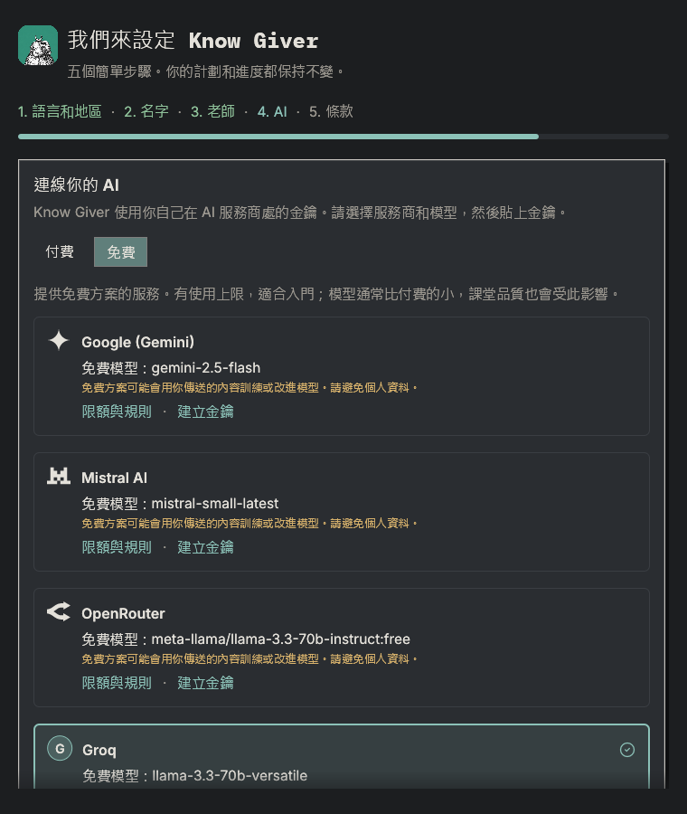
</p>

<table>
  <tr>
    <td>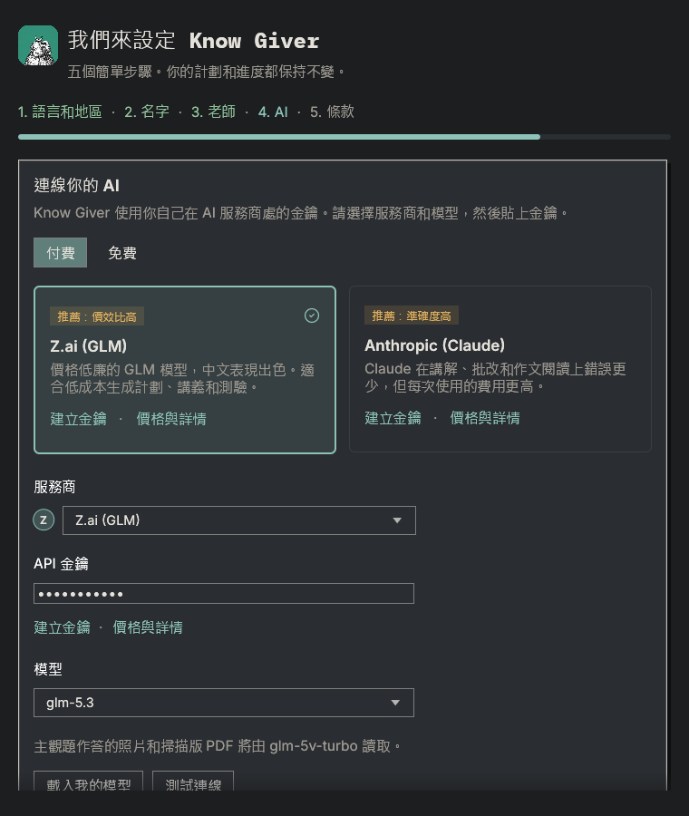</td>
    <td>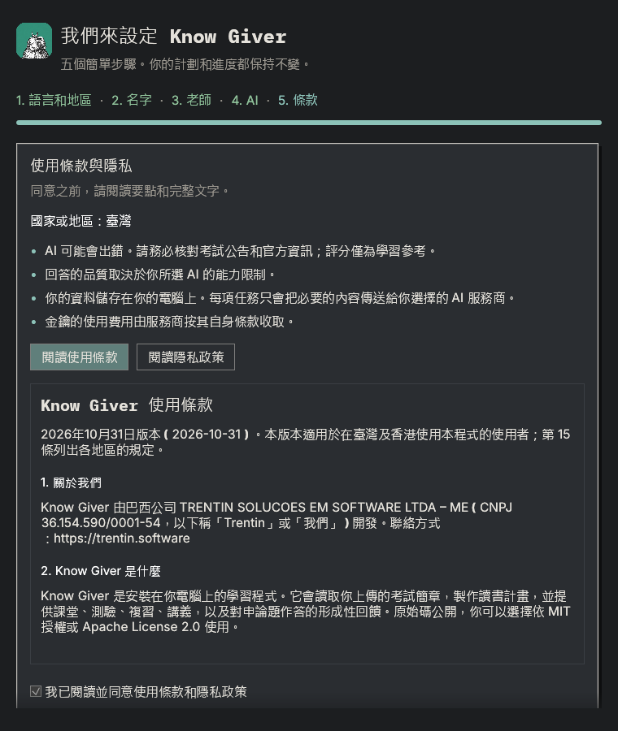</td>
  </tr>
</table>

<p align="center">
  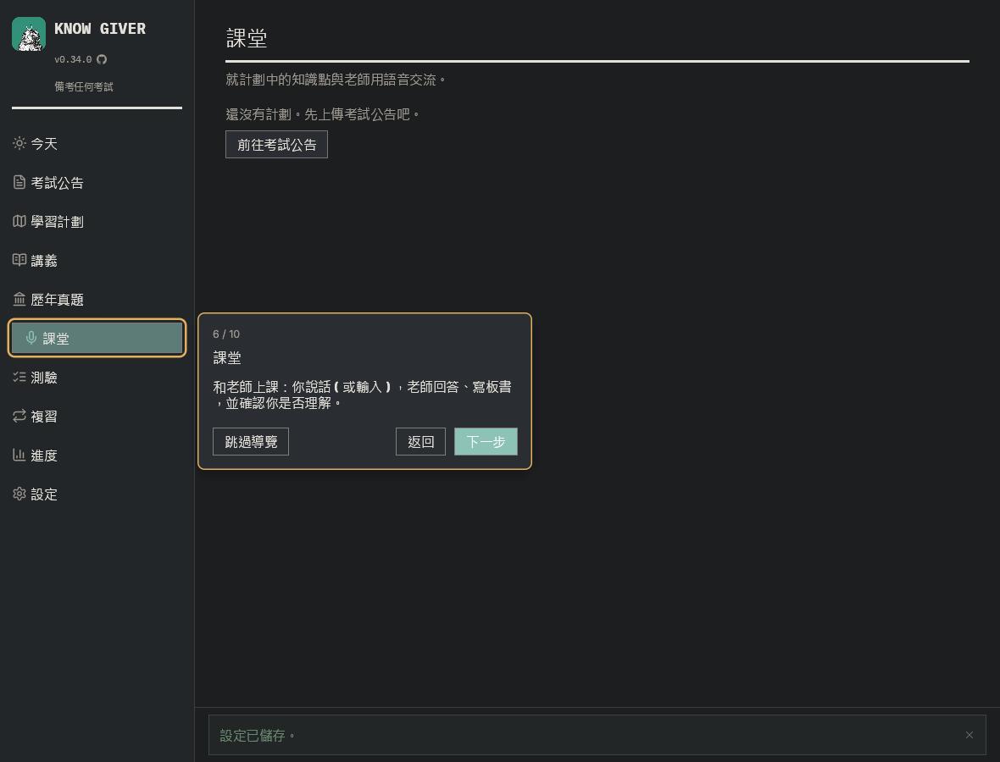
</p>

## 隱私

- 語音識別和朗讀在你的電腦上執行，錄音不會離開電腦。
- 資料（SQLite 資料庫、模型、日誌）儲存在 `%LOCALAPPDATA%\KnowGiver`。
- 只有任務所需的文字會傳送給你配置的 AI 服務。只有在設定了圖片模型時，答卷照片才會傳送給該模型。
- 開啟時，程式會向 GitHub 查詢最新版本；只傳送這個請求，可在 設定 → 關於與更新 中關閉。
- 沒有賬戶、遙測或廣告。

Know Giver 在臺灣、香港、新加坡、巴西、美國、歐盟、英國和日本向公眾提供；臺灣與香港的條款見[使用條款](docs/legal/terms-of-use.zh-Hant.md)和[隱私權政策](docs/legal/privacy-policy.zh-Hant.md)，也會在程式中顯示。在其他國家和地區，僅限經書面授權的合作夥伴依[合作夥伴存取條款](docs/legal/partner-access.zh-Hant.md)使用。

## 安裝

每個版本都會發布為 [GitHub Release](https://github.com/czarist/know-giver/releases/latest)，提供 Windows（x64）、macOS（Apple 晶片）與 Linux（x86_64）的安裝包。下面的指令會下載最新版本，用 Release 的檢查碼核對後，為目前的使用者安裝，不需要系統管理員權限。你的計畫與進度都會保留。

**Windows**（PowerShell）：

```powershell
irm https://raw.githubusercontent.com/czarist/know-giver/main/scripts/install.ps1 | iex
```

**macOS**（終端機）：

```bash
curl -fsSL https://raw.githubusercontent.com/czarist/know-giver/main/scripts/install.sh | bash
```

**Linux**（終端機）：

```bash
curl -fsSL https://raw.githubusercontent.com/czarist/know-giver/main/scripts/install.sh | bash
```

Windows 安裝到 `%LOCALAPPDATA%\Programs\KnowGiver`，並加入開始功能表；macOS 安裝到 `~/Applications/Know Giver.app`；Linux 安裝到 `~/.local/opt/KnowGiver`，並提供 `know-giver` 指令與應用程式選單項目。

首次安裝時會詢問是否建立**桌面捷徑**，更新時保留先前的選擇。**解除安裝**：Windows 在 設定 → 應用程式 → Know Giver（也可用開始功能表中的「Uninstall Know Giver」，或程式資料夾中的 `unins000.exe`）；macOS 執行 `"~/Applications/Know Giver.app/Contents/Resources/uninstall.sh"`；Linux 執行 `~/.local/opt/KnowGiver/uninstall.sh`。解除安裝程式會詢問是否一併刪除學習資料，除非你選擇「是」，否則會保留。

**更新：** 有新版本時，程式頂端會出現一條細列，以綠色的下載按鈕提示更新。程式會下載、核對、安裝，然後重新開啟。可在 設定 → 關於與更新 中關閉檢查。

## 開始使用

```bash
cargo run --release
```

首次啟動時會開啟首次設定。需要 Rust 1.95 或更新版本。Windows 安裝包：

```powershell
powershell -ExecutionPolicy Bypass -File scripts\package.ps1
```

開發相關內容請參閱 [English README](README.md#development)（技術文件為英文）。

## 許可證

可選擇依 [MIT](LICENSE-MIT) 或 [Apache License 2.0](LICENSE-APACHE) 使用（`MIT OR Apache-2.0`）。第三方字型、肖像、語音和標誌各有其許可（見 [English README 的 Credits](README.md#credits)）。報告安全漏洞請參閱 [SECURITY.md](SECURITY.md)。
